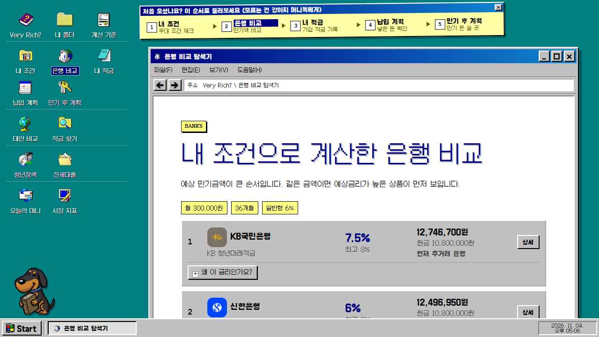
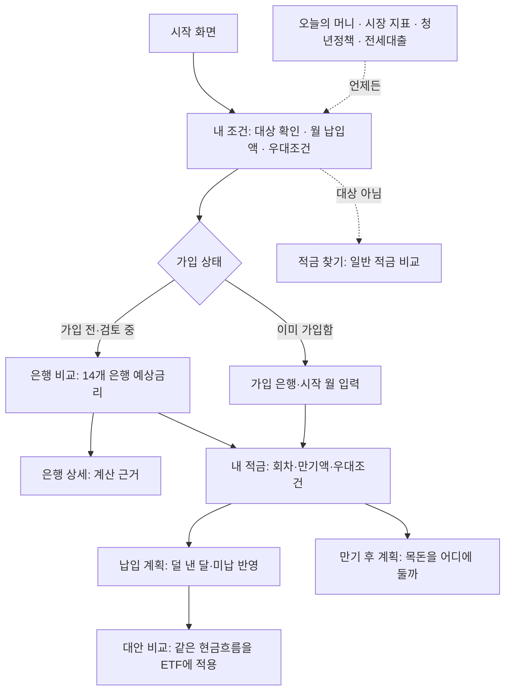
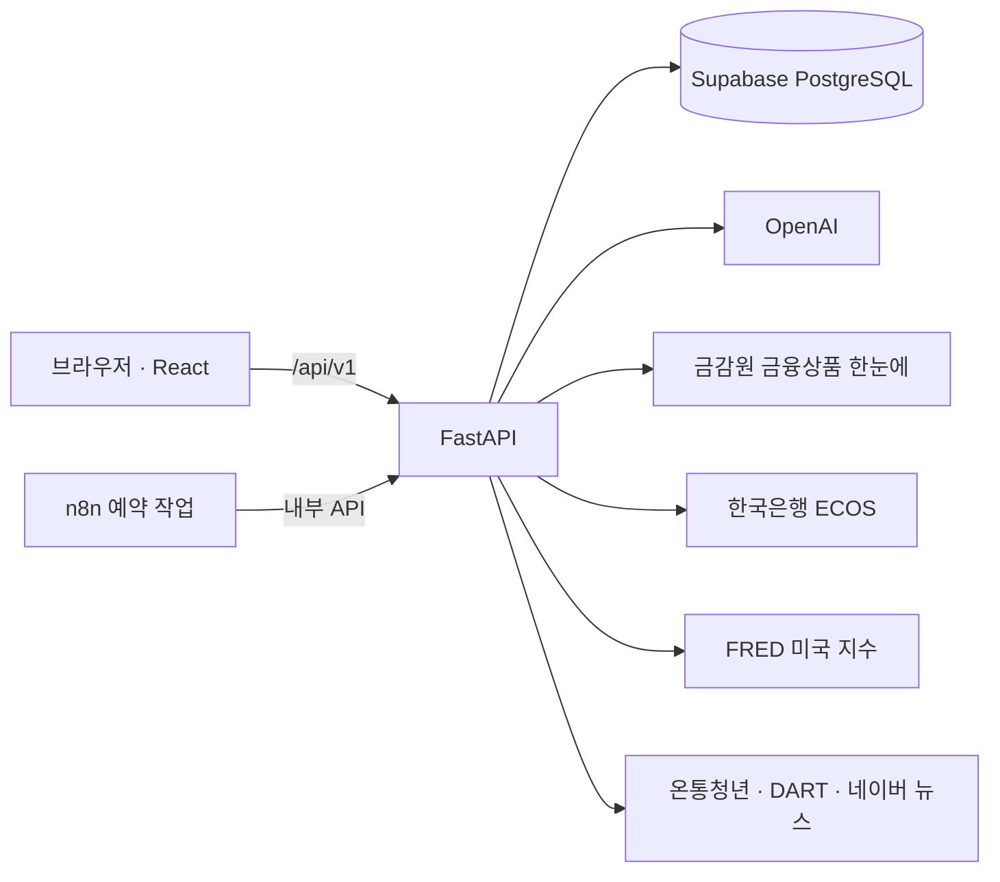

# Very Rich?

> **Hello ChatGPT, How to be rich, very rich?**
> 청년미래적금의 실제 우대조건과 월별 납입 흐름을 계산하고, 같은 돈을 다른 선택에 썼을 때의 차이를 비교하는 금융 의사결정 도구입니다.

[](https://www.youtube.com/shorts/wOGZ5JctSFE)

[YouTube Shorts에서 영상 보기](https://www.youtube.com/shorts/wOGZ5JctSFE)



- 발표·시연용 서비스 명세서: **[docs/presentation.md](docs/presentation.md)** (화면별 플로우, 시연 순서, 예상 질문)
- 개발·운영 상세 기록: [docs/operations.md](docs/operations.md)

## 왜 만들었나

은행이 안내하는 최고금리는 모든 사람이 받을 수 있는 금리가 아닙니다. 우대조건은 복잡하고, 매달 같은 금액을 넣기 어려운 사람도 있습니다. 적금과 ETF 같은 다른 선택을 비교하려 해도 서로 다른 기준의 숫자가 나와 판단하기 어렵습니다.

Very Rich?는 네 가지 질문에 답합니다.

1. 내가 **실제로 채울 수 있는** 우대조건은 무엇인가?
2. 그 조건을 반영한 **예상금리와 예상 만기액**은 얼마인가?
3. 월마다 납입액이 달라지면(덜 넣거나 건너뛰면) 결과가 **어떻게 바뀌는가**?
4. 같은 날짜와 금액을 다른 예·적금, 나스닥100·SCHD·QLD·채권·코스닥150에 적용하면 **어떤 차이**가 있는가?

특정 은행이나 자산을 추천하지 않습니다. 계산 근거, 채우지 못한 조건, 확인이 필요한 내용, 투자 위험을 함께 보여 주는 것이 핵심입니다.

## 서비스 한눈에 보기

화면은 1990년대 데스크톱 운영체제를 본뜬 레트로 UI입니다. 바탕화면 아이콘을 누르면 같은 화면 안에서 기능 창이 열리고, 아이콘은 성격이 비슷한 것끼리 네 묶음으로 놓여 있습니다.

| 묶음 | 아이콘 (경로) | 하는 일 |
|---|---|---|
| **내 적금 관리** | 내 조건 (`/conditions`) | 가입 대상 확인, 월 납입액·기여금 유형·우대조건 입력 |
| | 은행 비교 (`/banks`) | 14개 은행의 예상금리·만기액 비교, 계산 근거 |
| | 내 적금 (`/my-savings`) | 지금 몇 회차인지, 예상 만기액, 우대조건 체크, 캘린더 알림 |
| | 납입 계획 (`/cashflow`) | 36개월 납입액을 달마다 고쳐 만기액 다시 계산 |
| | 만기 후 계획 (`/maturity`) | 만기 목돈을 예금·ETF에 두었을 때 과거 결과로 비교 |
| | 해지 전 계산 (`/early-exit`) | 지금 깨면 받는 돈(기본금리 기준 참고값)·잃는 것과 깨지 않고 버티는 방법 비교 |
| **상품 탐색** | 대안 비교 (`/alternatives`) | 같은 현금흐름을 적금과 ETF 5종에 적용 |
| | 적금 찾기 (`/general-savings`) | 금감원 공시 일반 적금을 세후 만기액으로 비교 |
| **부가 서비스** | 청년정책 (`/youth-policies`) | 온통청년의 청년정책 약 3,900건 검색 |
| | 전세대출 (`/rent-loans`) | 공시된 전세자금대출의 월 이자·총이자 비교 |
| **오늘의 시장** | 오늘의 머니 (`/daily`) | AI가 정리한 경제 뉴스, 일정, 용어, 재무제표 |
| | 시장 지표 (`/market`) | 환율·증시·금리·물가 |
| 기타 | 계산 기준 (`/about`), 쉬운 용어 풀이 (`/terms`), 로그인 (`/auth`), 내 정보 (`/me`) | 출처·계산 방법, 용어, 계정 |

도우미 강아지 **머니독**은 모든 화면에서 질문에 답합니다(사이트 사용법, 용어, 오늘의 시장, 이자 계산, 내 적금 정보 등).

### 이용 흐름



처음 온 사람에게는 바탕화면 포스트잇이 `내 조건 → 은행 비교 → 내 적금 → 납입 계획 → 만기 후 계획` 순서를 알려 줍니다. 화면별 입력·결과·예외는 [서비스 명세서](docs/presentation.md)에 모두 적었습니다.

## 지켜야 할 원칙

- **추천하지 않습니다.** 은행·상품·자산을 권하거나 수익을 보장하지 않고, 같은 기준으로 계산해 비교만 합니다.
- **숫자는 서버가 계산합니다.** 금융 계산은 FastAPI 한 곳에서만 하고, 프론트엔드는 결과를 보여 줍니다.
- **출처와 기준일을 함께 보여 줍니다.** 금융감독원 공시, 한국은행 ECOS, 미국 연준(FRED), 금융위원회·서민금융진흥원, 온통청년, DART.
- **개인 입력은 서버에 저장하지 않습니다.** 비회원의 답변은 이 브라우저에만 임시 저장하고, 로그인해 직접 저장을 누른 것만 계정에 저장합니다. 머니독에게 "내 적금" 같은 내 정보를 물을 때만 계산에 필요한 값을 그 질문과 함께 보내며, 서버는 저장도 로그도 남기지 않습니다.
- **AI 답변은 검증합니다.** 머니독과 뉴스 요약은 근거 자료에 있는 숫자만 말할 수 있고, 추천·예측·근거 없는 숫자는 서버가 거절합니다. AI가 쓴 글에는 AI 표시를 붙입니다.

## 기술 구조

| 구분 | 기술 | 역할 |
|---|---|---|
| 프론트엔드 | React 19 + TypeScript + Vite | 입력, 화면 이동, 결과 표시, 브라우저 임시 저장 |
| 백엔드 | FastAPI + SQLAlchemy | 입력 검증, 공식 기준 데이터 조회, 모든 금융 계산, AI 호출 |
| 운영 DB | Supabase PostgreSQL (+ pgvector) | 상품·금리·우대조건·시장 지표·뉴스 요약·머니독 지식 조각 |
| 개발·테스트 DB | SQLite3 | 로컬 자동 테스트 |
| 인증 | Supabase Auth | 회원가입·로그인, 저장한 계획·관심 상품 |
| 자동화 | n8n (Docker) | 매일 07:30 시장·뉴스 수집, 15:30 뉴스 한 번 더 |
| AI | OpenAI Responses API, 임베딩 | 뉴스 요약, 머니독 답변(RAG), 해외 기사 한국어 해석 |



## 현재 상태

- 기능: 위 화면 전부 구현, 로컬에서 실제 공시 데이터로 동작 확인.
- 테스트: 프론트엔드 243개, 백엔드 362개 자동 테스트 통과(코드가 올라올 때마다 GitHub Actions CI가 같은 테스트와 빌드를 돌립니다). 머니독은 질문 묶음 평가(일반·말투·안전성)와 검색 품질 평가(hit@5 100%)를 따로 돌립니다.
- 배포: **2026-11-09 예정**. 개인정보 처리방침(`/privacy`)·이용약관(`/service-terms`) 화면과 가입 동의는 만들었고(법률 검토와 문의 연락처 입력 필요), 배포 전에 서버 경로 설정(SPA), 허용 주소(CORS), 실패 알림이 남았습니다.
- 알려진 한계: 방금 난 뉴스는 아침·오후 갱신 때까지 머니독에 반영되지 않고, 실제 휴대폰·화면 낭독기 확인은 하지 못했습니다.

## 실행 방법

사전 준비: Python 3.13, Node.js, Supabase 프로젝트. 비밀값은 코드와 문서에 넣지 않고 `backend/.env`, `frontend/.env`에만 둡니다(이름은 [`backend/.env.example`](backend/.env.example), [`frontend/.env.example`](frontend/.env.example) 참고).

```powershell
# 1. 백엔드 준비 (프로젝트 루트)
py -m venv .venv
.\.venv\Scripts\python.exe -m pip install -r backend\requirements-dev.txt

# 2. DB 테이블 준비 (backend\.env에 Supabase 연결 정보 입력 후)
cd backend
..\.venv\Scripts\python.exe -m alembic upgrade head

# 3. FastAPI 실행 → http://localhost:8000/docs
..\.venv\Scripts\python.exe -m uvicorn app.main:app --reload

# 4. React 실행 (새 PowerShell) → http://localhost:5173
cd frontend
npm.cmd install
npm.cmd run dev
```

테스트와 빌드:

```powershell
cd backend;  ..\.venv\Scripts\python.exe -m pytest
cd frontend; npm.cmd run lint; npm.cmd run test; npm.cmd run build
```

Supabase 연결 안내는 [database_setup.md](docs/database_setup.md), 매일 자동 수집(n8n)은 [automation/n8n/README.md](automation/n8n/README.md), 데이터 수집 명령과 기준자료 갱신은 [operations.md](docs/operations.md)에 있습니다.

## 문서

| 문서 | 내용 |
|---|---|
| [presentation.md](docs/presentation.md) | **발표·시연용 서비스 명세서** — 플로우, 화면별 상세, 시연 순서, 예상 질문 |
| [MVP](docs/mvp.md) | 첫 버전의 사용자, 문제, 기능 범위와 제외 범위 |
| [PRD](docs/PRD.md) | 화면, 기능, 데이터와 완료 조건 |
| [기능 동작 설명서](docs/spec.md) | 기능별 입력, 정상 결과, 오류와 검증 방법 |
| [개발 계획](docs/plan.md) | Phase별 구현 순서와 완료 기록 |
| [개발·운영 기록](docs/operations.md) | Phase별 진행 상태, 수집·갱신 명령, 브리핑 API |
| [브리핑 수집·요약 기준](docs/daily_briefing_policy.md) | 공식 출처, AI 검증과 보안 원칙 |
| [세션 인수인계](docs/SESSION_HANDOFF.md) | 현재 구현 상태와 실행법 |

## 협업 방식

Claude Code가 구현하고 Codex가 리뷰하는 멀티에이전트 방식으로 개발했습니다. 역할과 작업 넘기기 규칙은 [AGENTS.md](AGENTS.md)에 있습니다.

## 주의사항

Very Rich?가 보여 주는 금액은 입력값과 공개된 기준 자료로 계산한 **예상 결과**입니다. 실제 가입 조건과 수령액은 금융기관의 최종 확인이 필요합니다. 투자 비교 결과는 과거 데이터에 기반한 설명 자료이며 수익을 보장하거나 매수·매도를 추천하지 않습니다. 화면에 쓴 일부 아이콘은 공개 배포 전에 사용 권한을 확인할 예정입니다.
