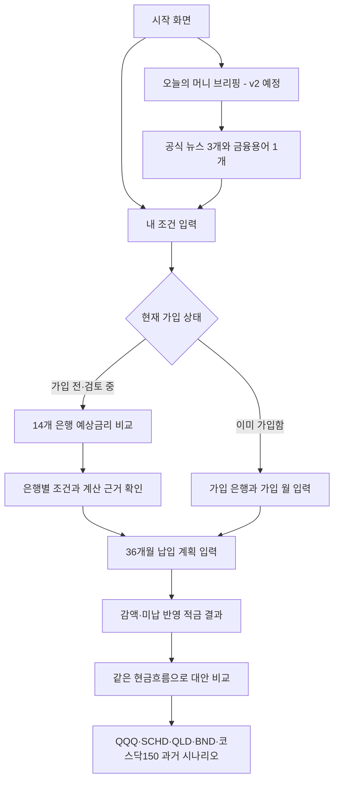

# Very Rich?

> **Hello ChatGPT, How to be rich, very rich?**
> 청년미래적금의 실제 우대조건과 월별 납입 흐름을 계산하고, 같은 돈을 다른 선택에 사용했을 때의 차이를 비교하는 금융 의사결정 도구입니다.

[](https://www.youtube.com/shorts/wOGZ5JctSFE)

[YouTube Shorts에서 영상 보기](https://www.youtube.com/shorts/wOGZ5JctSFE)

## 프로젝트 소개

은행이 안내하는 최고금리는 모든 사용자가 받을 수 있는 금리가 아닙니다. 우대조건은 복잡하고, 매월 같은 금액을 납입하기 어려운 사람도 있습니다. 적금과 ETF 같은 대안을 비교하려 해도 서로 다른 기준의 숫자가 제시되어 판단하기 어렵습니다.

Very Rich?는 다음 질문에 답하는 것을 목표로 합니다.

- 내가 실제로 충족할 수 있는 우대조건은 무엇인가?
- 조건을 반영한 예상금리와 예상 만기액은 얼마인가?
- 월마다 납입액이 달라지면 결과가 어떻게 바뀌는가?
- 같은 날짜와 금액을 다른 예·적금, 나스닥100, SCHD, QLD, 채권 또는 코스닥150에 적용하면 어떤 차이가 있는가?

특정 은행이나 자산을 추천하지 않습니다. 계산 근거, 충족하지 못한 조건, 확인이 필요한 내용과 투자 위험을 함께 보여주는 것이 핵심입니다.

## 전체 서비스 흐름



1. `/conditions`에서 가입 상태, 월 납입액, 정부기여금 유형과 우대조건을 입력합니다.
2. 가입 전 사용자는 `/banks`에서 14개 은행을 비교하고 `/banks/{은행코드}`에서 계산 근거를 확인합니다.
3. 이미 가입한 사용자는 가입 은행과 가입 월을 입력한 뒤 바로 `/cashflow`로 이동합니다.
4. `/cashflow`에서 36개월 납입액을 수정합니다. 덜 낸 달은 실제 금액, 미납한 달은 0원으로 입력합니다.
5. FastAPI가 변경된 원금·이자·정부기여금·예상 만기액을 다시 계산합니다.
6. `/alternatives`에서 같은 월별 금액을 적금과 QQQ·SCHD·QLD·BND·KODEX 코스닥150 과거 자료에 적용합니다.
7. 결과와 함께 최대 낙폭, 레버리지 위험, 환율·세금·수수료 반영 여부와 출처를 확인합니다.

v2에서는 `/daily`에서 공식 경제·금융 뉴스 최대 3개와 오늘의 금융용어 1개를 확인하고 관련 계산 화면으로 이동하는 데일리 흐름을 추가할 예정입니다.

사용자 입력은 브라우저에 임시 저장되고, 금융 계산은 FastAPI에서 수행됩니다. Supabase에는 상품·금리·우대조건·시장 기준자료를 저장하며 비회원의 개인 입력은 저장하지 않습니다.

## 현재 진행 상태

- 완료: **Phase 0 — 개발 기준 확정**
- 완료: **Phase 1 — React·FastAPI·SQLite3 기반 구축**
- 완료: **Phase 2 — SQLite3 공식 상품 데이터 구축**
- 완료: **Phase 3 — 적금 계산 API 완성**
- 완료: **Phase 3.5 — Supabase Auth 인증 기반 구축**
- 완료: **Phase 4 — 은행 비교 세로 흐름 완성**
- 완료: **Phase 5 — 월별 납입 기능 완성**
- 완료: **Phase 6 — 투자 데이터와 계산 완성**
- 완료: **Phase 7 — 적금·투자 비교 화면 완성**
- 완료: **Phase 8 핵심 작업 — Supabase PostgreSQL 연결·마이그레이션·상품 적재**
- 완료: **Phase 9 — 오류 응답·입력 유지·360px 모바일·계산 회귀 테스트·회원가입 동작 확인**
- 완료: **Phase 15 — `/daily` 화면, 국내·해외 뉴스 헤드라인(해외는 AI 한국어 번역·요약), 오늘의 금융용어 12개 공개(저장 30개 중 점검 통과분)**
- 도우미 머니독의 AI 답변(`POST /api/v1/assistant/chat`)도 `VERY_RICH_OPENAI_API_KEY`가 필요하며, 키가 없으면 키워드 답변만 합니다. 접속 주소별 분당 5회·하루 60회로 제한합니다.
- 머니독은 RAG로 답합니다. 사이트 안내, 공개 용어, 날짜별 경제 뉴스 요약과 "오늘 소식과 내 돈", 시장 지표, 다가올 공식 일정을 조각으로 나눠 OpenAI 임베딩과 Supabase pgvector에 저장하고, 질문과 가까운 5개만 근거로 넘겨 답 아래에 근거를 보여 줍니다. 답의 숫자는 인용한 근거에 있어야 합니다. 자료는 n8n 매일 작업 끝에 바뀐 것만 다시 임베딩하며, 직접 만들 때는 `cd backend && python -m scripts.build_knowledge`. 검색 품질은 `python -m scripts.eval_knowledge`로 잽니다(2026-11-03, 질문 32개, 의미 검색에 글자 일치를 더한 하이브리드: hit@1 81%, hit@5 100%, MRR 0.89 / 의미 검색만: 62%, 97%, 0.76).
- 해외 헤드라인 한국어 해석에는 `backend/.env`의 `VERY_RICH_OPENAI_API_KEY`가 필요합니다.
- 시장 지표(`/market`): 환율·코스피·코스닥·금리·해외 주요국 지수(월간)·소비자물가 상승률(전년 같은 달 대비, ECOS 소비자물가지수로 계산)과 금리·물가 흐름 그래프. 새 물가 숫자가 들어온 뒤 3일 동안은 `/daily` 맨 위에도 나옵니다. 수집은 `cd backend && python -m scripts.collect_market_data`이며 `backend/.env`에 `VERY_RICH_ECOS_API_KEY`(한국은행 ECOS 인증키)가 필요합니다.
- 매일 자동 수집: n8n 워크플로 `automation/n8n/workflows/daily-market-news-jobs.json`이 오전 7시 30분에 시장 지표와 뉴스·요약 작업을 FastAPI 내부 API(`POST /api/v1/internal/daily/jobs/{market|news}`)로 실행하고 결과를 실행 기록에 남깁니다. 설정은 `automation/n8n/README.md` 8절.
- `/daily`는 맨 위 "오늘 한눈에"(AI 한 줄 요약, 전 영업일보다 달라진 지표 ▲/▼)와 `요약 | 뉴스 | 일정 | 용어 | 재무제표` 탭으로 나뉘고, 권유·예측 안내는 맨 아래 한 곳에 모았습니다. 요약 탭의 "만약 기준금리가 바뀐다면?"은 오르는 경우·그대로·내리는 경우의 적금 만기 금액을 같은 조건으로 나란히 계산합니다(예측 없음). `일정` 탭은 금통위·FOMC·물가 발표·선거 같은 공식 일정을 D-day와 출처로 보여 줍니다(`GET /api/v1/events`, 날짜는 `backend/app/services/events.py`에 출처와 함께 직접 관리).
- `/daily`의 금리 관계 설명과 오늘의 금융용어는 "금융 선생님"이 쉬운 말로 풀어 줍니다. 금리 관계 설명 맨 위의 "오늘 소식과 내 돈"은 매일 뉴스 요약을 만들 때 AI가 함께 쓰며(예측·권유 표현과 근거 없는 숫자는 서버가 거절), 그 아래 일반 설명은 고정 문장입니다. 쉬운 설명 문구를 고친 뒤 DB에 반영하려면 `cd backend && python -m scripts.import_financial_terms --explanations-only`를 실행합니다.
- 헤드라인 수집: `cd backend && python -m scripts.collect_news_headlines` (네이버 키는 `backend/.env`의 `VERY_RICH_NAVER_*`에 입력, 하루 한 번 실행). 같은 실행에서 AI가 "오늘의 경제 뉴스 요약"(한 줄 개요와 3~5개 항목, 항목마다 원문 링크)을 만들어 `/daily` 맨 위에 보여 줍니다.
- 진행 중: **Phase 16 로컬 범위 — 수집 실행 기록·상태 API(`/internal/daily/runs`), 하루 토큰 상한 표시, 비밀값 검사 완료**. 운영 위치 결정, 예약 실행 3회 연속 성공, n8n 워크플로 기록 노드 연결, 360px 전체 QA는 남았습니다.
- 구현 완료(미커밋): **Phase 17 — 납입 감액 영향 설명**. `/cashflow`의 "이번 달 납입이 달라지면?"에서 한 달을 원래대로·감액·미납했을 때 만기액·이자·정부기여금 차이를 비교합니다(`POST /api/v1/savings/month-impact`). 중도해지 조건은 계산하지 않고 "추가 확인 필요"로 표시합니다. 실제 Supabase 호출과 360px 화면은 아직 확인하지 못했습니다.
- 완료: **Phase 18 — 만기 후 계획**(바탕화면 열쇠 아이콘, `/maturity`). 만기 금액을 성향(안정·중립·공격)에 맞춰 예금 재예치와 ETF 5종의 과거 12·24개월 보유 범위로 나란히 비교하고, 예금과 섞어 볼 수 있습니다(`POST /api/v1/maturity-plan`). `실제 정기예금으로 보면`에서는 금감원에 공시된 은행·저축은행 정기예금마다 내 금액을 맡겼을 때 세후로 받는 돈을 계산해 보여 줍니다(`POST /api/v1/maturity-plan/deposit-products`). 특정 상품을 권하지 않습니다.
- 납입 계획에는 해지 전 확인할 것, 만기 후 계획에는 만기 30일 전 캘린더 알림(.ics)이 있습니다. 금액 입력칸은 입력 중에도 1,000,000 형식으로 보입니다.
- 동의한 사용자에게서만 화면별 하루 사용 횟수를 익명으로 셉니다(누가 썼는지·입력값은 보내지 않음). 수신(예금·적금) 사업에 붙이는 가정 제안서: [`docs/proposal_deposit_growth.md`](docs/proposal_deposit_growth.md)
- 예·적금 공시 금리 변동: 금융감독원 「금융상품 한눈에」 Open API로 매일 은행·저축은행 예·적금 금리를 모아 어제와 바뀐 것만 %p로 시장 지표에 보여 줍니다. `backend/.env`에 `VERY_RICH_FINLIFE_API_KEY`를 넣으면 동작하며, 없으면 건너뜁니다(2026-11-03 키 연결, 첫 수집 3,571개 상품·기간).
- 로그인하면 내 정보의 "저장한 계획"에 지금 입력을 이름 붙여 저장(최대 10개)하고 다른 기기에서 불러올 수 있습니다. 저장 버튼을 누를 때만 저장하며 언제든 지울 수 있습니다(`/api/v1/me/plans`).
- 실제 정기예금 목록에서 상품마다 가입 조건(우대 조건·대상·방법·한도)을 펼쳐 볼 수 있고, `☆ 관심`을 누른 상품이나 내 적금 은행의 공시 금리가 전날과 달라지면 첫 화면과 오늘의 머니 위에 알려 줍니다(관심 상품은 이 기기에만 저장).
- 은행 비교 결과는 링크(월 납입액·기여금 유형·은행·우대조건 답만 담고 받는 사람 화면에서 다시 계산)나 이미지로 공유할 수 있습니다(`/share`).
- `내 적금`(바탕화면 통장 아이콘, `/my-savings`)에서 지금 몇 회차인지, 예상 만기금액, 넣은 돈·남은 돈·건너뛴 회차, 우대조건 상태와 '모름' 조건을 채우면 늘어나는 금액, 다가올 일정과 금리 알림을 한 화면에서 봅니다.
- 내 조건 화면(`/conditions`) 맨 위에서 청년미래적금 대상인지 직접 고르거나, 생년월일·소득·가구 소득을 넣어 금융위원회가 발표한 2차 가입 기준으로 우대형·일반형·대상 아님을 확인하고(입력값은 저장하지 않음), 대상이 아니거나 확인 중이면 `일반 적금 비교`(`/general-savings`)에서 금감원에 공시된 은행·저축은행 적금마다 매달 넣은 돈이 만기에 세후 얼마가 되는지 봅니다.
- 내 적금에서 납입 중이면 매달 우대조건을 채웠는지 체크하고(이 기기에만 저장), 못 채우면 만기금액이 얼마나 줄어드는지 봅니다.
- 내 적금에서 만기 알림과 매달 우대조건 확인 알림을 캘린더 파일로 받고, 관심 상품을 관리하며 로그인하면 원할 때만 계정에 저장해 다른 기기에서 불러올 수 있습니다(`/api/v1/me/watchlist`, 마이그레이션 `20261103_0017`).
- 은행 재무제표와 공시: DART Open API로 은행 11곳의 사업보고서 주요 숫자를 모아 은행 상세에 `재무제표 한눈에`로 보여 주고, `/daily` 뉴스 탭에 은행·금융지주 공시를, `재무제표` 탭에 실제 숫자로 배우는 `재무제표 읽는 법`을 둡니다. 숫자를 옮기고 나눗셈만 하며 은행의 안전성을 판단하지 않습니다. `backend/.env`에 `VERY_RICH_DART_API_KEY`가 있어야 수집합니다.
- 다음: 2026-11-09 배포, Phase 16 남은 항목(예약 3회 연속 성공, 실패 알림, 상시 서버), Phase 10 사용자 테스트
- 완료: **Phase 11 — 공식 출처·저장 범위·Scrapling 제한·AI 검증 기준 확정**
- 완료: **Phase 12 — 브리핑 DB·API 기반**
- 완료: **Phase 13 — n8n 공식 피드 수집**
- 완료: **Phase 14 — `gpt-5.6-luna`로 공식 자료 13건 실호출 평가, 사실 검증 통과**
- 현재 은행별 적금과 36개월 변동 납입을 계산하고, 같은 현금흐름을 QQQ·SCHD·QLD·BND·KODEX 코스닥150 과거 시계열과 한 화면에서 비교할 수 있습니다.

Phase 0에서 확정한 내용은 다음과 같습니다.

- 프론트엔드와 백엔드를 분리한다.
- 핵심 금융 계산은 FastAPI 한 곳에서 수행한다.
- 로컬 개발과 자동 테스트에는 SQLite3를 사용한다.
- 운영 기준 데이터는 Supabase PostgreSQL에 저장한다.
- 비회원의 답변과 납입액은 브라우저에만 임시 보관한다.
- Supabase Auth 기반 회원가입·로그인을 제공하며, 로그인 사용자만 자신의 기록을 저장할 수 있게 확장한다.

Phase 1에서 준비한 내용은 다음과 같습니다.

- React 화면 경로와 모바일 공통 레이아웃
- FastAPI `/api/v1` 구조와 공통 오류 응답
- SQLite 기준 데이터 테이블과 초기 연결 레코드
- React에서 FastAPI·SQLite 상태를 확인하는 연결 화면
- 브라우저 로컬 저장 모듈
- 프론트엔드와 백엔드 자동 테스트

## 핵심 기능 범위

1. 사용자 조건에 따른 은행별 예상 우대금리 비교
2. 예상 이자, 정부기여금과 만기 수령액 확인
3. 감액과 미납을 포함한 월별 납입액 입력
4. 동일한 월별 현금흐름을 사용한 적금과 대안상품 비교
5. 상품 출처, 계산 기준과 확인 필요 조건 표시
6. 브라우저 입력 복원과 전체 초기화

## 기술 구조

| 구분 | 기술 | 역할 |
|---|---|---|
| 프론트엔드 | React + TypeScript | 입력, 화면 이동, 결과 표시, 브라우저 임시 저장 |
| 백엔드 | FastAPI | 입력 검증, 공식 기준 데이터 조회, 금융 계산 |
| 개발·테스트 DB | SQLite3 | 로컬 개발과 자동 테스트 |
| 운영 DB | Supabase PostgreSQL | 은행·상품·우대조건·출처·투자 기준 데이터와 v2 뉴스·용어 |
| 자동화(v2) | n8n | 공식 피드 예약 수집, OpenAI 호출, 재시도와 실행 기록 |
| AI(v2) | OpenAI Responses API | JSON Schema 기반 뉴스 요약 초안 생성 |

비회원 입력은 서버에 저장하지 않습니다. 로그인 사용자의 개인 기록과 별도 동의를 받은 익명 분석 데이터는 추후 Supabase에 분리 저장합니다. 프론트엔드는 핵심 금융 계산식을 복제하지 않고 FastAPI의 계산 결과를 표시합니다.

## 디자인 방향

화면은 1990년대 데스크톱 운영체제에서 영감을 받은 레트로 시스템 UI를 사용합니다.

- 청록색 바탕화면과 바로가기 아이콘
- 파란 제목 표시줄과 입체 테두리 창
- 하단 작업표시줄과 시작 메뉴
- 아이콘을 누르면 같은 데스크톱 안에서 기능 창이 열리는 구조
- 열린 금융 화면과 놀이용 앱을 작업표시줄에서 각각 최소화·복원하는 다중 창 구조
- 날짜·실시간 시계, 바탕화면 드래그 선택 상자
- 메모장·그림판·계산기·지뢰찾기는 바탕화면에 따로 두지 않고 모두 `내 폴더` 안에서 실행
- 사용자가 제공한 레퍼런스 시트에서 선택해 추출한 픽셀 아이콘 6종
- 놀이용 앱 아이콘도 사용자가 제공한 픽셀 아이콘 시트의 유사 아이콘을 사용
- 브라우저 파비콘은 보라색 물음표 책 아이콘을 사용하고, 금융 대시보드 6개 아이콘은 새로 제공된 Windows 98 아이콘 시트를 우선 사용
- 공개 배포 전 레퍼런스 아이콘의 사용 권한을 확인할 예정

## 문서 안내

- [MVP](docs/mvp.md): 첫 버전의 사용자, 문제, 기능 범위와 제외 범위
- [PRD](docs/PRD.md): 화면, 기능, 데이터와 완료 조건
- [기능 동작 설명서](docs/spec.md): 기능별 입력, 정상 결과, 오류와 검증 방법
- [개발 계획](docs/plan.md): Phase별 구현 순서, 의존 관계와 완료 기준
- [브리핑 수집·요약 기준](docs/daily_briefing_policy.md): 공식 출처, Scrapling 제한, AI 검증과 보안 원칙
- [세션 인수인계 명세서](docs/SESSION_HANDOFF.md): 다른 세션에서 바로 이어가기 위한 현재 구현 상태·실행법·다음 작업

## 개발 로드맵

- [x] Phase 0 — 개발 기준 확정
- [x] Phase 1 — React·FastAPI·SQLite3 기반 구축
- [x] Phase 2 — SQLite3 공식 상품 데이터 구축
- [x] Phase 3 — 적금 계산 API 완성
- [x] Phase 3.5 — Supabase Auth 인증 기반 구축
- [x] Phase 4 — 은행 비교 세로 흐름 완성
- [x] Phase 5 — 월별 납입 기능 완성
- [x] Phase 6 — 투자 데이터와 계산 완성
- [x] Phase 7 — 적금·투자 비교 완성
- [x] Phase 8 — Supabase 운영 연결
- [x] Phase 9 — 출처·오류·통합 QA
- [ ] Phase 10 — 사용자 테스트와 공개 준비
- [x] Phase 11 — v2 기준·출처 확정
- [x] Phase 12 — 브리핑 DB·API 기반
- [x] Phase 13 — n8n 공식 피드 수집
- [x] Phase 14 — OpenAI 요약·사실 검증
- [x] Phase 15 — `/daily` 화면·오늘의 금융용어
- [ ] Phase 16 — v2 통합 QA·운영 준비 (실행 기록 API·토큰 상한 완료, 운영 배포·예약 3회 성공 남음)
- [x] Phase 19 — 도우미 머니독 AI 질문 답변

각 Phase의 상세 작업과 완료 조건은 [개발 계획](docs/plan.md)에서 확인할 수 있습니다.

## 실행 방법

### 1. 백엔드 환경 준비

프로젝트 루트의 PowerShell에서 실행합니다.

```powershell
py -m venv .venv
.\.venv\Scripts\python.exe -m pip install -r backend\requirements-dev.txt
```

### 2. Supabase DB 환경 설정과 테이블 준비

[`backend/.env.example`](backend/.env.example)을 참고해 `backend/.env`에 Supabase Session pooler 연결 정보를 입력한 뒤 실행합니다.

```powershell
cd backend
..\.venv\Scripts\python.exe -m alembic upgrade head
```

상세 설정과 오류 확인 방법은 [Supabase PostgreSQL 연결 안내](docs/database_setup.md)를 참고합니다. 설정이 없거나 잘못되어도 SQLite로 자동 연결하지 않습니다.

### 3. FastAPI 실행

```powershell
cd backend
..\.venv\Scripts\python.exe -m uvicorn app.main:app --reload
```

- API 문서: `http://localhost:8000/docs`
- 상태 확인: `http://localhost:8000/api/v1/health`

서버는 `backend/.env`의 PostgreSQL 연결만 사용합니다. 기존 SQLite 파일은 삭제하지 않지만 서버 실행 DB로 자동 선택하지 않습니다.

### 4. React 실행

새 PowerShell을 열고 실행합니다.

```powershell
cd frontend
npm.cmd install
npm.cmd run dev
```

- 웹 화면: `http://localhost:5173`

### 5. 테스트와 빌드

백엔드:

```powershell
cd backend
..\.venv\Scripts\python.exe -m pytest
```

프론트엔드:

```powershell
cd frontend
npm.cmd run lint
npm.cmd run test
npm.cmd run build
```

### 6. 기준자료 갱신

투자 기준자료는 실행일을 기준으로 **마지막으로 완료된 월부터 최근 36개월**을 수집합니다. 가격·환율 누락, 지원 자산, 기간과 양수 여부를 모두 통과한 경우에만 Supabase의 기존 자료를 한 트랜잭션으로 교체합니다. 검증이나 DB 반영이 실패하면 이전 정상 자료를 유지합니다.

로컬에서 수집과 검증만 확인하려면 다음 명령을 실행합니다. 이 명령은 DB를 수정하지 않습니다.

```powershell
cd backend
..\.venv\Scripts\python.exe scripts\sync_market_data.py --dry-run
```

검증 후 Supabase에 반영하려면 `--dry-run`을 빼고 실행합니다.

```powershell
..\.venv\Scripts\python.exe scripts\sync_market_data.py
```

`.github/workflows/reference-data.yml`은 매월 3일 오전 9시(KST)에 같은 작업을 실행합니다. GitHub 저장소의 `Settings > Secrets and variables > Actions`에 `VERY_RICH_DATABASE_URL`을 Repository secret으로 등록해야 하며 실제 값은 코드나 문서에 넣지 않습니다. Actions의 `Run workflow`에서 수동 실행도 가능합니다.

적금 공시는 매주 원문 변경 여부만 확인하고 자동으로 금리·조건을 덮어쓰지 않습니다. 변경이 감지되면 공식 원문과 현재 데이터를 사람이 대조한 뒤 다음 명령으로 검토한 페이지의 기준선을 갱신합니다.

```powershell
..\.venv\Scripts\python.exe scripts\check_savings_sources.py
..\.venv\Scripts\python.exe scripts\check_savings_sources.py --write-baseline
```

환경값을 바꿔야 할 때는 [프론트 예시](frontend/.env.example)와 [백엔드 예시](backend/.env.example)를 참고해 각각의 폴더에 `.env`를 만듭니다. 예시 파일에는 실제 비밀값을 넣지 않습니다.

### 7. 멀티에이전트 작업 (Claude Code 구현 · Codex 리뷰)

역할 분담과 작업 넘기기 규칙은 [AGENTS.md](AGENTS.md)에 있습니다. `CLAUDE.md`는 이 규칙을 불러온 뒤 Claude의 역할만 덧붙입니다.

```powershell
relay\start.cmd                     # Windows Terminal에 claude / codex / relay 3분할로 실행
powershell -ExecutionPolicy Bypass -File relay\send.ps1 claude "할 일"   # 직접 작업 넣기
```

`relay.ps1`은 `relay/inbox/<에이전트>/`에 생긴 작업 파일을 순서대로 하나씩 해당 CLI로 실행합니다. 진행 기록은 `relay/board.md`, 실행 출력은 `relay/logs/`에 남고 둘 다 Git에는 올라가지 않습니다.

## 보안과 데이터 원칙

- `.env`처럼 비밀번호나 API 키가 들어갈 수 있는 파일은 Git에 저장하지 않습니다.
- 실제 SQLite 데이터베이스 파일과 설치·빌드 결과도 Git에서 제외합니다.
- 공유가 필요한 환경변수 이름은 값이 비어 있는 `.env.example`로만 관리합니다.
- Supabase 비밀값은 백엔드 실행 환경에만 두고 React 코드에 포함하지 않습니다.
- OpenAI API 키는 공식 뉴스 요약 워크플로용은 n8n Credential에, FastAPI가 쓰는 해외 해석·경제 뉴스 요약·머니독 답변용은 `backend/.env`(`VERY_RICH_OPENAI_API_KEY`)에만 두고 workflow JSON·React·Git에 포함하지 않습니다.
- n8n과 FastAPI 사이의 내부 비밀값도 실제 값은 환경변수 또는 Credential로만 관리합니다.

## 데일리 브리핑 API 기반

Phase 12에서는 공식 출처·원문 메타데이터·검증 결과·AI 요약·검수된 금융용어를 Supabase에 저장하는 구조를 만들었습니다. 기사 전문과 수집에 사용한 근거 문단은 저장하지 않습니다.

- `POST /api/v1/internal/daily/briefings`: n8n 전용 저장 API입니다. `X-Very-Rich-Ingest-Secret` 헤더 인증이 필요합니다.
- `GET /api/v1/daily?date=YYYY-MM-DD`: 검증을 통과한 브리핑 최대 3개와 해당 날짜의 검수된 금융용어를 반환합니다. 날짜를 생략하면 한국 시간의 오늘을 사용합니다.
- 동일한 공식 식별자·URL·본문 해시는 중복 저장하지 않습니다.
- 출처 권한, 날짜 순서, 근거 문단, 숫자와 금지 표현 검증에 실패한 결과는 `rejected`로 남고 공개 API에는 표시되지 않습니다.
- 실제 내부 비밀값은 `backend/.env`의 `VERY_RICH_N8N_INGEST_SECRET`에서만 관리합니다.

### 2. Phase 13 공식 금융뉴스 후보 수집

Phase 13에서는 로컬 Docker n8n이 매일 오전 7시(KST)에 FastAPI 내부 수집 API를 호출하는 흐름을 준비했습니다. 금융위원회 공식 자료는 RSS를 먼저 시도하고 실패하면 공개 목록을 제한적으로 확인하며, 한국은행 RSS는 원문 발견용으로만 구분합니다. 후보는 날짜·공식 출처·중복 여부를 확인하고 요약 대상은 최대 3개로 제한합니다.

- n8n 준비·실행·워크플로 가져오기: [automation/n8n/README.md](automation/n8n/README.md)
- 후보 수집 API: `GET /api/v1/internal/daily/candidates/collect`
- 내부 인증 헤더: `X-Very-Rich-Ingest-Secret`
- 부분 실패 시 성공한 출처는 계속 처리하고, 전체 실패 시 게시 단계로 넘길 후보를 만들지 않습니다.
- 워크플로 JSON에는 비밀번호·API 키·내부 비밀값을 넣지 않고 환경변수 이름만 기록합니다.
- Phase 14 구현으로 공식 원문의 근거 문단 준비, OpenAI Structured Outputs, FastAPI 재검증·저장까지 연결했습니다.

### 3. Phase 14 AI 요약과 사실 검증

- 금융위원회 상세 원문에서 최대 12개·총 16,000자의 근거 문단만 메모리에서 준비합니다.
- 근거 준비 API는 `POST /api/v1/internal/daily/candidates/evidence`, AI 결과 검증·저장 API는 `POST /api/v1/internal/daily/briefings/openai-result`입니다.
- OpenAI 요청에는 공식 제목·발표일·근거 문단만 포함하고 사용자 답변이나 금융정보는 포함하지 않습니다.
- JSON Schema 1.0으로 쉬운 제목, 핵심 내용, 중요한 이유, 관련 용어와 고정 주의문구를 받습니다.
- FastAPI가 응답 완료 여부, 거절, JSON 형식, 근거 ID, 숫자와 금지 표현을 다시 검사합니다.
- 후보는 하루 최대 3개, 검증 실패 재요청은 항목별 한 번, 출력은 요청당 최대 900토큰입니다.
- 개발 기본 모델은 `gpt-5.6-luna`이며 n8n 환경값으로 변경할 수 있습니다.
- 이 공식 뉴스 요약 워크플로의 API 키는 n8n OpenAI Credential에 직접 등록합니다(2026-10-30 등록·실호출 확인, 금융위 보도자료 13건 표본 평가 완료 — `docs/plan.md` 27절). FastAPI가 호출하는 해외 해석·경제 뉴스 요약·머니독 답변용 키는 따로 `backend/.env`의 `VERY_RICH_OPENAI_API_KEY`에 둡니다.
- 워크플로에서 `access to env vars denied`가 나오면 실제 실행 중인 n8n Compose에 `N8N_BLOCK_ENV_ACCESS_IN_NODE=false`가 들어갔는지 확인하고 컨테이너를 재생성합니다. 저장소의 Compose가 아닌 다른 n8n 인스턴스를 실행 중일 수 있으므로 컨테이너의 Compose 경로도 함께 확인합니다.

## 주의사항

Very Rich?가 보여주는 금액은 입력값과 공개된 기준 자료를 사용한 예상 결과입니다. 실제 가입 조건과 수령액은 금융기관의 최종 확인이 필요합니다. 투자 비교 결과는 과거 데이터에 기반한 설명 자료이며 수익을 보장하거나 매수·매도를 추천하지 않습니다.

## 현재 구현 상태

- 청년미래적금 14개 취급기관의 기본금리·최고금리·우대조건을 Supabase에 저장합니다.
- `/conditions`에서 월 납입액, 정부기여금 유형, 은행별 우대조건을 입력할 수 있습니다.
- 가입 상태·가입 월·전환 여부·주거래 은행을 브라우저에 임시 저장하고 전체 초기화할 수 있습니다.
- `/banks`에서 예상금리·만기금액·주거래 은행 대비 차액을 비교하고 `/banks/{은행코드}`에서 계산 근거를 확인할 수 있습니다.
- `/cashflow`에서 36개월 납입액을 각각 수정하고 미납 월을 0원으로 입력해 원금·이자·정부기여금·만기액과 고정 납입 대비 차액을 확인할 수 있습니다.
- `/api/v1/investments`는 마지막으로 완료된 월부터 최근 36개월의 QQQ·SCHD·QLD·BND·KODEX 코스닥150 조정주가로 동일 현금흐름의 과거 시나리오를 계산합니다.
- `/alternatives`에서 적금과 선택한 투자 대안의 종료금액·증감·최대 낙폭·위험·출처를 비교할 수 있습니다.
- `/about`에서 설문 표본·조사기간, 적금·투자 계산 방법, 상품별 출처·기준일과 미반영 요소를 확인할 수 있습니다.
- 투자 계산은 배당 재투자와 환율을 반영하지만 개인별 세금과 증권사 거래 수수료는 반영하지 않습니다.
- KODEX 코스닥150은 코스닥 전체지수가 아니라 대표 150종목을 추종하는 원화 ETF이며 환율을 적용하지 않습니다.
- 레트로 기능 창은 이동·크기 조절·최소화·최대화·복원이 가능합니다.
- 창 안의 뒤로·앞으로 버튼으로 이전 기능 화면과 다음 기능 화면을 다시 열 수 있습니다.
- 상품 공시 확인일은 2026년 10월 13일이며, 실제 가입 전 연결된 공시 원문을 다시 확인해야 합니다.

## v2 예정 기능: 오늘의 머니 브리핑

- 기존 설문으로 검증된 요구가 아니라, 재방문과 금융 이해에 도움이 되는지 확인할 제품 가설입니다.
- `docs/daily_briefing_policy.md`에서 이용 범위를 확인한 공식 자료만 사용합니다.
- 일반 언론사 기사 전문을 무단 크롤링하거나 재게시하지 않습니다.
- 하루 최대 3개의 뉴스와 검수된 금융용어 1개를 `/daily`에 표시합니다.
- AI 요약에는 출처·발표일·생성 시각과 AI 표시를 붙입니다.
- Structured Outputs로 형식을 고정하되 숫자·날짜·출처는 FastAPI에서 별도로 검증합니다.
- 뉴스 요약에 개인 금융정보를 전달하지 않으며 상품 추천·주가 예측으로 사용하지 않습니다.
- 첫 버전은 푸시·이메일 뉴스레터, 개인화 추천과 광고를 포함하지 않습니다.
