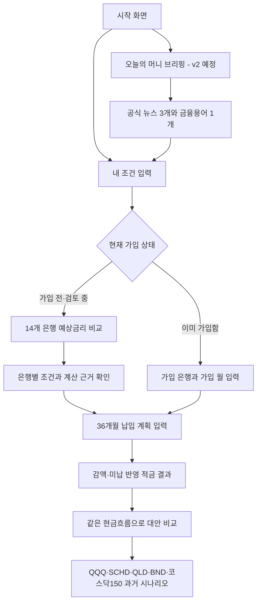

# Very Rich?

> **Hello ChatGPT, How to be rich, very rich?**
> 청년미래적금의 실제 우대조건과 월별 납입 흐름을 계산하고, 같은 돈을 다른 선택에 사용했을 때의 차이를 비교하는 금융 의사결정 도구입니다.

[](https://youtube.com/shorts/1CQJrG-Z6XI?si=UaGlE4YFqL7Dh_Aq)

[YouTube Shorts에서 영상 보기](https://youtube.com/shorts/1CQJrG-Z6XI?si=UaGlE4YFqL7Dh_Aq)

## 프로젝트 소개

은행이 안내하는 최고금리는 모든 사용자가 받을 수 있는 금리가 아닙니다. 우대조건은 복잡하고, 매월 같은 금액을 납입하기 어려운 사람도 있습니다. 적금과 ETF 같은 대안을 비교하려 해도 서로 다른 기준의 숫자가 제시되어 판단하기 어렵습니다.

Very Rich?는 다음 질문에 답하는 것을 목표로 합니다.

- 내가 실제로 충족할 수 있는 우대조건은 무엇인가?
- 조건을 반영한 예상금리와 예상 만기액은 얼마인가?
- 월마다 납입액이 달라지면 결과가 어떻게 바뀌는가?
- 같은 날짜와 금액을 다른 예·적금, 나스닥100, SCHD, QLD, 채권 또는 코스닥150에 적용하면 어떤 차이가 있는가?

특정 은행이나 자산을 추천하지 않습니다. 계산 근거, 충족하지 못한 조건, 확인이 필요한 내용과 투자 위험을 함께 보여주는 것이 핵심입니다.

## 전체 서비스 흐름



1. `/conditions`에서 가입 상태, 월 납입액, 정부기여금 유형과 우대조건을 입력합니다.
2. 가입 전 사용자는 `/banks`에서 14개 은행을 비교하고 `/banks/{은행코드}`에서 계산 근거를 확인합니다.
3. 이미 가입한 사용자는 가입 은행과 가입 월을 입력한 뒤 바로 `/cashflow`로 이동합니다.
4. `/cashflow`에서 36개월 납입액을 수정합니다. 덜 낸 달은 실제 금액, 미납한 달은 0원으로 입력합니다.
5. FastAPI가 변경된 원금·이자·정부기여금·예상 만기액을 다시 계산합니다.
6. `/alternatives`에서 같은 월별 금액을 적금과 QQQ·SCHD·QLD·BND·KODEX 코스닥150 과거 자료에 적용합니다.
7. 결과와 함께 최대 낙폭, 레버리지 위험, 환율·세금·수수료 반영 여부와 출처를 확인합니다.

v2에서는 `/daily`에서 공식 경제·금융 뉴스 최대 3개와 오늘의 금융용어 1개를 확인하고 관련 계산 화면으로 이동하는 데일리 흐름을 추가할 예정입니다.

사용자 입력은 브라우저에 임시 저장되고, 금융 계산은 FastAPI에서 수행됩니다. Supabase에는 상품·금리·우대조건·시장 기준자료를 저장하며 비회원의 개인 입력은 저장하지 않습니다.

## 현재 진행 상태

- 완료: **Phase 0 — 개발 기준 확정**
- 완료: **Phase 1 — React·FastAPI·SQLite3 기반 구축**
- 완료: **Phase 2 — SQLite3 공식 상품 데이터 구축**
- 완료: **Phase 3 — 적금 계산 API 완성**
- 완료: **Phase 3.5 — Supabase Auth 인증 기반 구축**
- 완료: **Phase 4 — 은행 비교 세로 흐름 완성**
- 완료: **Phase 5 — 월별 납입 기능 완성**
- 완료: **Phase 6 — 투자 데이터와 계산 완성**
- 완료: **Phase 7 — 적금·투자 비교 화면 완성**
- 완료: **Phase 8 핵심 작업 — Supabase PostgreSQL 연결·마이그레이션·상품 적재**
- 진행 중: **Phase 9 — 계산 기준·출처 화면과 기준자료 갱신 자동화 완료, 오류·모바일·통합 QA 진행 예정**
- 완료: **Phase 11 — 공식 출처·저장 범위·Scrapling 제한·AI 검증 기준 확정**
- 다음: **Phase 12 — 브리핑 DB·API 기반**
- 현재 은행별 적금과 36개월 변동 납입을 계산하고, 같은 현금흐름을 QQQ·SCHD·QLD·BND·KODEX 코스닥150 과거 시계열과 한 화면에서 비교할 수 있습니다.

Phase 0에서 확정한 내용은 다음과 같습니다.

- 프론트엔드와 백엔드를 분리한다.
- 핵심 금융 계산은 FastAPI 한 곳에서 수행한다.
- 로컬 개발과 자동 테스트에는 SQLite3를 사용한다.
- 운영 기준 데이터는 Supabase PostgreSQL에 저장한다.
- 비회원의 답변과 납입액은 브라우저에만 임시 보관한다.
- Supabase Auth 기반 회원가입·로그인을 제공하며, 로그인 사용자만 자신의 기록을 저장할 수 있게 확장한다.

Phase 1에서 준비한 내용은 다음과 같습니다.

- React 화면 경로와 모바일 공통 레이아웃
- FastAPI `/api/v1` 구조와 공통 오류 응답
- SQLite 기준 데이터 테이블과 초기 연결 레코드
- React에서 FastAPI·SQLite 상태를 확인하는 연결 화면
- 브라우저 로컬 저장 모듈
- 프론트엔드와 백엔드 자동 테스트

## 핵심 기능 범위

1. 사용자 조건에 따른 은행별 예상 우대금리 비교
2. 예상 이자, 정부기여금과 만기 수령액 확인
3. 감액과 미납을 포함한 월별 납입액 입력
4. 동일한 월별 현금흐름을 사용한 적금과 대안상품 비교
5. 상품 출처, 계산 기준과 확인 필요 조건 표시
6. 브라우저 입력 복원과 전체 초기화

## 기술 구조

| 구분 | 기술 | 역할 |
|---|---|---|
| 프론트엔드 | React + TypeScript | 입력, 화면 이동, 결과 표시, 브라우저 임시 저장 |
| 백엔드 | FastAPI | 입력 검증, 공식 기준 데이터 조회, 금융 계산 |
| 개발·테스트 DB | SQLite3 | 로컬 개발과 자동 테스트 |
| 운영 DB | Supabase PostgreSQL | 은행·상품·우대조건·출처·투자 기준 데이터와 v2 뉴스·용어 |
| 자동화(v2) | n8n | 공식 피드 예약 수집, OpenAI 호출, 재시도와 실행 기록 |
| AI(v2) | OpenAI Responses API | JSON Schema 기반 뉴스 요약 초안 생성 |

비회원 입력은 서버에 저장하지 않습니다. 로그인 사용자의 개인 기록과 별도 동의를 받은 익명 분석 데이터는 추후 Supabase에 분리 저장합니다. 프론트엔드는 핵심 금융 계산식을 복제하지 않고 FastAPI의 계산 결과를 표시합니다.

## 디자인 방향

화면은 1990년대 데스크톱 운영체제에서 영감을 받은 레트로 시스템 UI를 사용합니다.

- 청록색 바탕화면과 바로가기 아이콘
- 파란 제목 표시줄과 입체 테두리 창
- 하단 작업표시줄과 시작 메뉴
- 아이콘을 누르면 같은 데스크톱 안에서 기능 창이 열리는 구조
- 사용자가 제공한 레퍼런스 시트에서 선택해 추출한 픽셀 아이콘 6종
- 공개 배포 전 레퍼런스 아이콘의 사용 권한을 확인할 예정

## 문서 안내

- [MVP](docs/mvp.md): 첫 버전의 사용자, 문제, 기능 범위와 제외 범위
- [PRD](docs/PRD.md): 화면, 기능, 데이터와 완료 조건
- [기능 동작 설명서](docs/spec.md): 기능별 입력, 정상 결과, 오류와 검증 방법
- [개발 계획](docs/plan.md): Phase별 구현 순서, 의존 관계와 완료 기준
- [브리핑 수집·요약 기준](docs/daily_briefing_policy.md): 공식 출처, Scrapling 제한, AI 검증과 보안 원칙

## 개발 로드맵

- [x] Phase 0 — 개발 기준 확정
- [x] Phase 1 — React·FastAPI·SQLite3 기반 구축
- [x] Phase 2 — SQLite3 공식 상품 데이터 구축
- [x] Phase 3 — 적금 계산 API 완성
- [x] Phase 3.5 — Supabase Auth 인증 기반 구축
- [x] Phase 4 — 은행 비교 세로 흐름 완성
- [x] Phase 5 — 월별 납입 기능 완성
- [x] Phase 6 — 투자 데이터와 계산 완성
- [x] Phase 7 — 적금·투자 비교 완성
- [x] Phase 8 — Supabase 운영 연결
- [ ] Phase 9 — 출처·오류·통합 QA
- [ ] Phase 10 — 사용자 테스트와 공개 준비
- [x] Phase 11 — v2 기준·출처 확정
- [ ] Phase 12 — 브리핑 DB·API 기반
- [ ] Phase 13 — n8n 공식 피드 수집
- [ ] Phase 14 — OpenAI 요약·사실 검증
- [ ] Phase 15 — `/daily` 화면·오늘의 금융용어
- [ ] Phase 16 — v2 통합 QA·운영 준비

각 Phase의 상세 작업과 완료 조건은 [개발 계획](docs/plan.md)에서 확인할 수 있습니다.

## 실행 방법

### 1. 백엔드 환경 준비

프로젝트 루트의 PowerShell에서 실행합니다.

```powershell
py -m venv .venv
.\.venv\Scripts\python.exe -m pip install -r backend\requirements-dev.txt
```

### 2. Supabase DB 환경 설정과 테이블 준비

[`backend/.env.example`](backend/.env.example)을 참고해 `backend/.env`에 Supabase Session pooler 연결 정보를 입력한 뒤 실행합니다.

```powershell
cd backend
..\.venv\Scripts\python.exe -m alembic upgrade head
```

상세 설정과 오류 확인 방법은 [Supabase PostgreSQL 연결 안내](docs/database_setup.md)를 참고합니다. 설정이 없거나 잘못되어도 SQLite로 자동 연결하지 않습니다.

### 3. FastAPI 실행

```powershell
cd backend
..\.venv\Scripts\python.exe -m uvicorn app.main:app --reload
```

- API 문서: `http://localhost:8000/docs`
- 상태 확인: `http://localhost:8000/api/v1/health`

서버는 `backend/.env`의 PostgreSQL 연결만 사용합니다. 기존 SQLite 파일은 삭제하지 않지만 서버 실행 DB로 자동 선택하지 않습니다.

### 4. React 실행

새 PowerShell을 열고 실행합니다.

```powershell
cd frontend
npm.cmd install
npm.cmd run dev
```

- 웹 화면: `http://localhost:5173`

### 5. 테스트와 빌드

백엔드:

```powershell
cd backend
..\.venv\Scripts\python.exe -m pytest
```

프론트엔드:

```powershell
cd frontend
npm.cmd run lint
npm.cmd run test
npm.cmd run build
```

환경값을 바꿔야 할 때는 [프론트 예시](frontend/.env.example)와 [백엔드 예시](backend/.env.example)를 참고해 각각의 폴더에 `.env`를 만듭니다. 예시 파일에는 실제 비밀값을 넣지 않습니다.

## 보안과 데이터 원칙

- `.env`처럼 비밀번호나 API 키가 들어갈 수 있는 파일은 Git에 저장하지 않습니다.
- 실제 SQLite 데이터베이스 파일과 설치·빌드 결과도 Git에서 제외합니다.
- 공유가 필요한 환경변수 이름은 값이 비어 있는 `.env.example`로만 관리합니다.
- Supabase 비밀값은 백엔드 실행 환경에만 두고 React 코드에 포함하지 않습니다.
- OpenAI API 키는 v2 개발 시 n8n Credential에만 등록하고 workflow JSON·React·Git에 포함하지 않습니다.
- n8n과 FastAPI 사이의 내부 비밀값도 실제 값은 환경변수 또는 Credential로만 관리합니다.

## 주의사항

Very Rich?가 보여주는 금액은 입력값과 공개된 기준 자료를 사용한 예상 결과입니다. 실제 가입 조건과 수령액은 금융기관의 최종 확인이 필요합니다. 투자 비교 결과는 과거 데이터에 기반한 설명 자료이며 수익을 보장하거나 매수·매도를 추천하지 않습니다.

## 현재 구현 상태

- 청년미래적금 14개 취급기관의 기본금리·최고금리·우대조건을 Supabase에 저장합니다.
- `/conditions`에서 월 납입액, 정부기여금 유형, 은행별 우대조건을 입력할 수 있습니다.
- 가입 상태·가입 월·전환 여부·주거래 은행을 브라우저에 임시 저장하고 전체 초기화할 수 있습니다.
- `/banks`에서 예상금리·만기금액·주거래 은행 대비 차액을 비교하고 `/banks/{은행코드}`에서 계산 근거를 확인할 수 있습니다.
- `/cashflow`에서 36개월 납입액을 각각 수정하고 미납 월을 0원으로 입력해 원금·이자·정부기여금·만기액과 고정 납입 대비 차액을 확인할 수 있습니다.
- `/api/v1/investments`는 2023년 10월~2026년 9월 QQQ·SCHD·QLD·BND·KODEX 코스닥150 조정주가로 동일 현금흐름의 과거 시나리오를 계산합니다.
- `/alternatives`에서 적금과 선택한 투자 대안의 종료금액·증감·최대 낙폭·위험·출처를 비교할 수 있습니다.
- 투자 계산은 배당 재투자와 환율을 반영하지만 개인별 세금과 증권사 거래 수수료는 반영하지 않습니다.
- KODEX 코스닥150은 코스닥 전체지수가 아니라 대표 150종목을 추종하는 원화 ETF이며 환율을 적용하지 않습니다.
- 레트로 기능 창은 이동·크기 조절·최소화·최대화·복원이 가능합니다.
- 창 안의 뒤로·앞으로 버튼으로 이전 기능 화면과 다음 기능 화면을 다시 열 수 있습니다.
- 상품 공시 확인일은 2026년 10월 13일이며, 실제 가입 전 연결된 공시 원문을 다시 확인해야 합니다.

## v2 예정 기능: 오늘의 머니 브리핑

- 기존 설문으로 검증된 요구가 아니라, 재방문과 금융 이해에 도움이 되는지 확인할 제품 가설입니다.
- `docs/daily_briefing_policy.md`에서 이용 범위를 확인한 공식 자료만 사용합니다.
- 일반 언론사 기사 전문을 무단 크롤링하거나 재게시하지 않습니다.
- 하루 최대 3개의 뉴스와 검수된 금융용어 1개를 `/daily`에 표시합니다.
- AI 요약에는 출처·발표일·생성 시각과 AI 표시를 붙입니다.
- Structured Outputs로 형식을 고정하되 숫자·날짜·출처는 FastAPI에서 별도로 검증합니다.
- 뉴스 요약에 개인 금융정보를 전달하지 않으며 상품 추천·주가 예측으로 사용하지 않습니다.
- 첫 버전은 푸시·이메일 뉴스레터, 개인화 추천과 광고를 포함하지 않습니다.
