# Very Rich? 서비스 명세서 (발표·시연용)

> 이 문서는 발표자가 서비스를 처음부터 끝까지 설명하고 시연할 수 있도록 만든 명세서입니다.
> 화면에 나오는 숫자는 **2026-11-04에 실제 서비스에서 읽은 값**이고, 같은 입력이면 다시 재현됩니다(날짜에 따라 달라지는 값은 따로 표시했습니다).
> 기능별 입력·오류·검증의 정식 기준은 [기능 동작 설명서](spec.md), 구현 기록은 [개발 계획](plan.md)에 있습니다.

## 목차

1. [한 장 요약](#1-한-장-요약)
2. [누가 쓰는가](#2-누가-쓰는가)
3. [전체 플로우](#3-전체-플로우)
4. [화면 구조: 레트로 데스크톱](#4-화면-구조-레트로-데스크톱)
5. [단계별 명세](#5-단계별-명세)
6. [계산 규칙](#6-계산-규칙)
7. [머니독 (AI 도우미)](#7-머니독-ai-도우미)
8. [데이터와 자동화](#8-데이터와-자동화)
9. [신뢰·안전 원칙](#9-신뢰안전-원칙)
10. [품질 확인 결과](#10-품질-확인-결과)
11. [시연 시나리오](#11-시연-시나리오)
12. [예상 질문과 답](#12-예상-질문과-답)
13. [한계와 앞으로](#13-한계와-앞으로)

---

## 1. 한 장 요약

**한 줄:** 은행이 광고하는 *최고금리*가 아니라, 내가 **실제로 받을 수 있는** 금리와 만기액을 계산하고, 같은 돈을 다른 선택에 썼을 때와 같은 기준으로 비교하는 서비스입니다.

| 질문 | 서비스의 답 | 화면 |
|---|---|---|
| 나는 청년미래적금에 가입할 수 있나? | 생년월일·소득·가구 소득으로 우대형·일반형·대상 아님 판정 | 내 조건 |
| 내가 채울 수 있는 우대조건으로 얼마를 받나? | 은행 14곳의 예상금리·만기액을 같은 기준으로 비교 | 은행 비교 |
| 지금 내 적금은 어떤 상태인가? | 몇 회차인지, 예상 만기액, 놓친 납입, 우대조건 상태 | 내 적금 |
| 덜 넣거나 건너뛰면? | 36개월 납입액을 달마다 고쳐 만기액 재계산 | 납입 계획 |
| 만기 목돈은 어디에 둘까? | 예금·ETF 5종을 같은 금액·같은 기간의 **과거 결과**로 비교 | 만기 후 계획 |
| 적금 말고 다른 선택은? | 같은 현금흐름을 ETF 5종에 적용 | 대안 비교 |
| 대상이 아니면? | 금감원 공시 일반 적금을 세후 만기액으로 비교 | 적금 찾기 |
| 그 밖에 받을 수 있는 혜택·대출은? | 청년정책 약 3,900건 검색, 전세자금대출 비교 | 청년정책 · 전세대출 |
| 오늘 경제 소식은 내 돈과 무슨 상관? | AI 요약 + 지표 + 일정 | 오늘의 머니 · 시장 지표 |

**차별점 세 가지**

1. **최고금리 대신 예상금리.** 우대조건을 "예 / 아니요 / 모름"으로 답하면, 채웠다고 한 조건만 더합니다. *모름은 더하지 않습니다.*
2. **현실의 납입.** 매달 똑같이 넣지 못하는 사람을 위해 달마다 금액을 고치고, 한 달을 0원으로 바꾸면 만기액이 얼마나 줄어드는지 보여 줍니다.
3. **추천하지 않는 비교.** 순위는 "만기액이 큰 순"일 뿐이고, 어떤 상품도 권하지 않습니다. 출처·기준일·확인이 필요한 조건을 항상 함께 보여 줍니다.

---

## 2. 누가 쓰는가

세 사람이 같은 서비스를 서로 다른 길로 씁니다. 시연에서는 **A → B** 순서로 보여 주는 것을 권합니다.

| 사용자 | 상황 | 주로 쓰는 화면 |
|---|---|---|
| **A. 가입 전·검토 중** (만 27세, 총급여 5,000만원) | 어느 은행에 가입할지, 대상은 맞는지 모름 | 내 조건 → 은행 비교 → 은행 상세 |
| **B. 이미 가입함** (KB국민은행, 2026년 9월 시작, 월 30만원) | 잘 넣고 있는지, 만기 후엔 어떻게 할지 궁금 | 내 적금 → 납입 계획 → 만기 후 계획 → 대안 비교 |
| **C. 대상이 아님** | 청년미래적금은 안 되니 일반 적금을 찾음 | 적금 찾기 (+ 청년정책, 전세대출) |

---

## 3. 전체 플로우

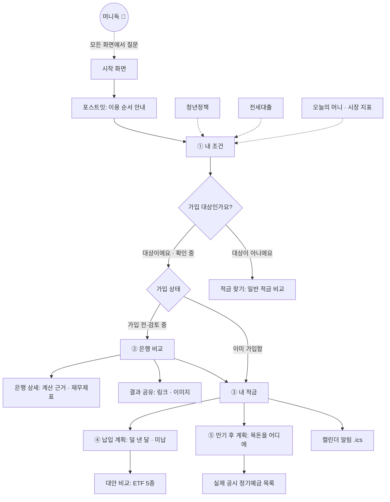

**공통 규칙:** 입력은 브라우저에 자동 저장되어 새로고침해도 이어지고, "처음부터 다시 입력"으로 지울 수 있습니다. 모든 금융 계산은 서버(FastAPI)가 하고, 화면은 그 결과를 보여 줍니다.

**화면이 이어지는 방식 (데이터 흐름)**

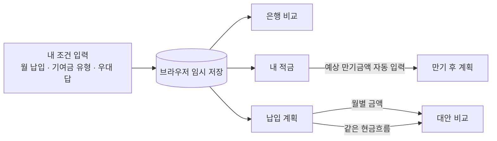

한 번 입력한 값이 모든 화면의 기준이 되므로, **화면마다 숫자가 서로 같습니다.** (예: 국민은행 월 30만원·일반형·우대 4개 충족이면 은행 비교·내 적금·만기 후 계획·머니독 모두 12,746,700원)

---

## 4. 화면 구조: 레트로 데스크톱

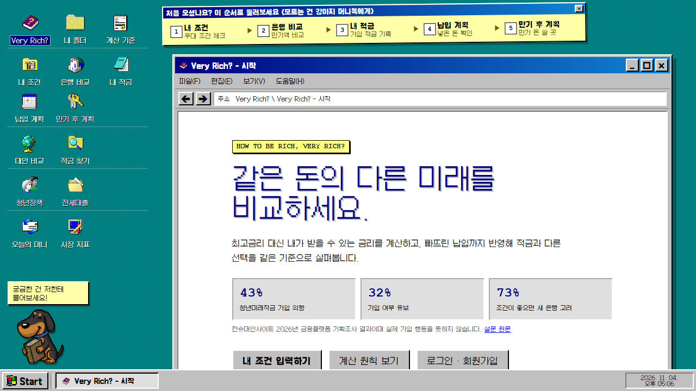

| 요소 | 동작 |
|---|---|
| **바탕화면 아이콘 4묶음** | 내 적금 관리 / 상품 탐색 / 부가 서비스 / 오늘의 시장. 점선으로 묶음을 나눔. 누르면 기능 창이 열림 |
| **기능 창** | 이동·크기 조절·최소화·최대화·복원. 창 안의 ←→ 버튼으로 이전/다음 화면. 최대화·복원을 반복해도 같은 자리로 돌아옴 |
| **포스트잇** | 처음 온 사람에게 `내 조건 → 은행 비교 → 내 적금 → 납입 계획 → 만기 후 계획` 순서를 안내. 닫으면 "메모" 조각이 남아 다시 열 수 있음 |
| **머니독** | 왼쪽 아래 강아지. 처음 방문 때 "궁금한 건 저한테 물어보세요!" 태그가 10초 보이고, 누르면 질문 창이 열림 |
| **시작 메뉴 · 작업표시줄** | 열린 창 목록, 시계, Start 메뉴 |
| **내 폴더** | 메모장·그림판·계산기·지뢰찾기가 들어 있는 놀이용 앱. 지뢰찾기는 판을 다 풀면 "다음 레벨"로 난이도가 한 단계씩 올라가 레벨 10(16×16, 지뢰 64개)까지 이어지고, 다시 열면 이어서 시작(레벨 기록은 이 기기에만 저장) |

**왜 레트로인가:** 금융 서비스는 딱딱해서 처음 온 사람이 겁먹기 쉽습니다. "컴퓨터 바탕화면에서 폴더를 여는" 익숙한 구조로 낮추고, 복잡한 기능을 아이콘 하나로 나눴습니다.

---

## 5. 단계별 명세

각 화면마다 **무엇을 입력하고 → 서버가 무엇을 계산해 → 무엇이 나오는지**, 그리고 **어떤 예외를 막는지**를 적었습니다.

### 5.1 시작 화면 `/`

- **목적:** 서비스가 무엇을 하는지 10초 안에 이해시키고 입력으로 보냅니다.
- **나오는 것:** 제목 "같은 돈의 다른 미래를 비교하세요.", 설문 근거 3개(청년미래적금 가입 의향 43%, 가입 여부 유보 32%, 조건이 좋으면 새 은행 고려 73%), 버튼 3개(내 조건 입력하기 · 계산 원칙 보기 · 로그인·회원가입).
- **근거 표기:** 컨슈머인사이트 2026년 금융플랫폼 기획조사 결과이며 *실제 가입 행동을 뜻하지 않는다*고 같은 줄에 적고 원문 링크를 답니다.
- **처음 방문:** 통계 수집 동의 바(동의한 사람에게서만 화면별 하루 사용 횟수를 익명으로 셈. 누가 썼는지·입력값은 보내지 않음).

### 5.2 내 조건 `/conditions` (사용자 A의 출발점)

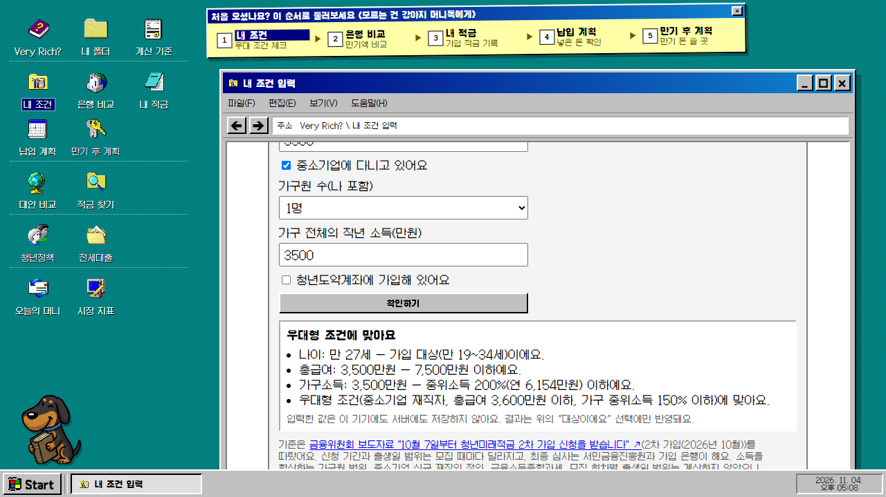

**① 가입 대상인가요?** — `대상이에요 / 확인 중이에요 / 대상이 아니에요` 중 직접 고르거나, `내 조건으로 확인해 보기`에서 계산합니다.

| 입력 | 예시(사용자 A) |
|---|---|
| 생년월일 | 1999-03-15 |
| 병역 복무 기간(개월, 최대 72) | 0 |
| 소득 종류 | 근로소득자(총급여) / 종합소득 신고자 / 소상공인(연매출) |
| 작년 총급여(만원) | 5,000 |
| 가구원 수 · 가구 전체의 작년 소득(만원) | 1명 · 5,000 |
| 청년도약계좌 가입 여부 | 아니요 |

- **결과(실측):** "**일반형으로 가입할 수 있어요**" — 나이 만 27세(가입 대상 만 19~34세), 총급여 5,000만원은 7,500만원 이하, 가구소득은 중위소득 200%(연 6,154만원) 이하. *우대형이 되려면* 중소기업 재직, 총급여 3,600만원 이하, 가구소득 중위소득 150% 이하가 필요하다고 부족한 이유를 알려 줍니다.
- **다른 판정:** 같은 사람이 중소기업 재직에 총급여 3,500만원이면 "우대형 조건에 맞아요". 그 밖에 "가입은 되지만 정부 기여금은 없어요", "청년도약계좌와는 중복 가입이 안 돼요", "가입 대상이 아니에요".
- **개인정보:** 입력한 생년월일·소득은 **이 기기에도 서버에도 저장하지 않습니다.** 결과는 위의 "대상이에요" 선택에만 반영됩니다.
- **계산하지 않는 것(화면에 고지):** 소득을 합산하는 가구원 범위, 중소기업 신규 재직 정의, 금융소득종합과세, 모집 회차별 출생일 범위. 최종 심사는 서민금융진흥원과 가입 은행이 합니다.

**② 계획 입력** — 현재 가입 상태(가입 전·검토 중 / 이미 가입함), 매달 넣을 금액, 정부기여금 유형(일반형 6% / 우대형 12% / 기여금 제외), 청년도약계좌 전환 여부, (가입했다면) 가입한 달·가입한 은행.

**③ 우대조건 질문** — 모든 은행에 공통인 질문 2개와 은행별 질문(선택)이 있습니다.

| 공통 질문 | 우대 |
|---|---|
| 소득 우대 기준을 충족하나요? (총급여 3,600만원 이하 또는 종합소득 2,600만원 이하) | +0.5%p |
| 기한 안에 청년 재무상담을 이수할 계획인가요? (만기 3개월 전까지 서민금융진흥원) | +0.2%p |

- 각 질문은 `예 / 아니요 / 모름`. **모름은 금리에 더하지 않습니다.** "지금은 건너뛰어도 비교할 수 있다"고 안내하고, 은행별 질문은 접어 둔 채 관심 은행만 펼쳐 답하게 합니다.
- 은행별 예: **KB국민은행** 급여이체 +1.0%p, 생활거래 +0.8%p. **신한은행** 급여이체 +0.3%p 등. 기본 5%, 은행마다 공시 최고 7~8%.
- **버튼:** `지금 답변으로 14개 비교하기`(이미 비교한 뒤에는 `14개 은행 다시 비교하기`, → 은행 비교), `가입 후 납입내역 계산하기`(→ 납입 계획), `처음부터 다시 입력`.
- **금액 입력 편의:** 칸에 "30만원", "1.5억", 전각 숫자를 붙여 넣어도 읽어 주고, 입력 중에도 `1,000,000` 형식으로 보입니다.

### 5.3 은행 비교 `/banks` (사용자 A의 결과)

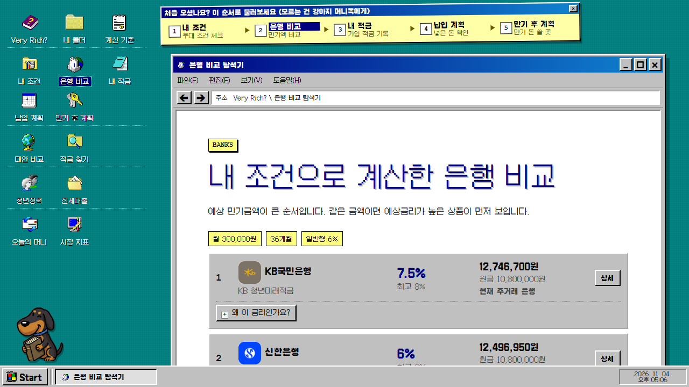

- **입력(자동):** 앞 화면의 월 납입액·기여금 유형·우대조건 답.
- **서버 계산:** 14개 취급기관마다 예상금리와 36개월 만기액을 계산(→ [6. 계산 규칙](#6-계산-규칙)).
- **나오는 것(실측, 월 30만원·일반형 6%, 공통 2개 + KB 급여이체·생활거래 "예"):**

| 순위 | 은행 | 예상금리 (최고) | 예상 만기액 | 현재 은행 대비 |
|---|---|---|---|---|
| 1 | KB국민은행 | 7.5% (8%) | 12,746,700원 | 현재 주거래 은행 |
| 2 | 신한은행* | 6% (8%) | 12,496,950원 | −249,750원 |
| 3~ | 나머지 은행 | 5.7% (7~8%) | 12,447,000원 | −299,700원 |

  *신한은 시연 중 급여이체 "예"를 답한 경우입니다. 답하지 않으면 다른 은행처럼 5.7%입니다. 원금은 모두 10,800,000원(30만원 × 36회).
- **정렬 규칙:** 예상 만기액이 큰 순, 같으면 예상금리가 높은 순. "순위"는 계산 결과일 뿐 추천이 아닙니다.
- **`왜 이 금리인가요?`** 를 펼치면 기본금리 → 붙은 우대금리 → 이 은행의 우대 한도, 조건마다 내 답(충족·미충족·모름)과 붙은 %p와 이유가 나옵니다.

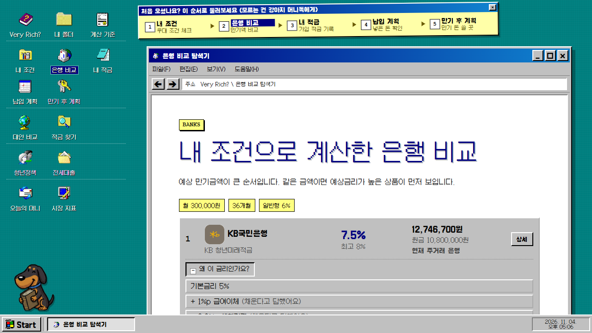

- **현재 은행 대비:** 내가 쓰는 은행을 고르면 다른 은행이 그보다 얼마 더/덜 받는지 보여 줍니다. 금액이 같은 은행은 "현재 은행과 같아요"로 표시합니다.
- **은행 상세 `/banks/{은행코드}`:** 계산 근거, 은행별 조건, DART 사업보고서 주요 숫자 `재무제표 한눈에`(숫자를 옮기고 나눗셈만 하며 은행의 안전성을 판단하지 않음).
- **공유 `/share`:** 월 납입액·기여금 유형·은행·우대조건 답만 담은 **링크**(받는 사람 화면에서 다시 계산)나 **이미지**로 공유.
- **대상이 아니라고 답했다면:** 맨 위에 "참고용이고 일반 적금 비교에서 받을 수 있는 적금을 볼 수 있다"는 안내가 뜹니다.
- **오류:** 서버 오류가 나면 빈 화면 대신 안내와 `다시 시도`, `조건 다시 입력하기`가 나옵니다.

### 5.4 내 적금 `/my-savings` (사용자 B의 출발점)

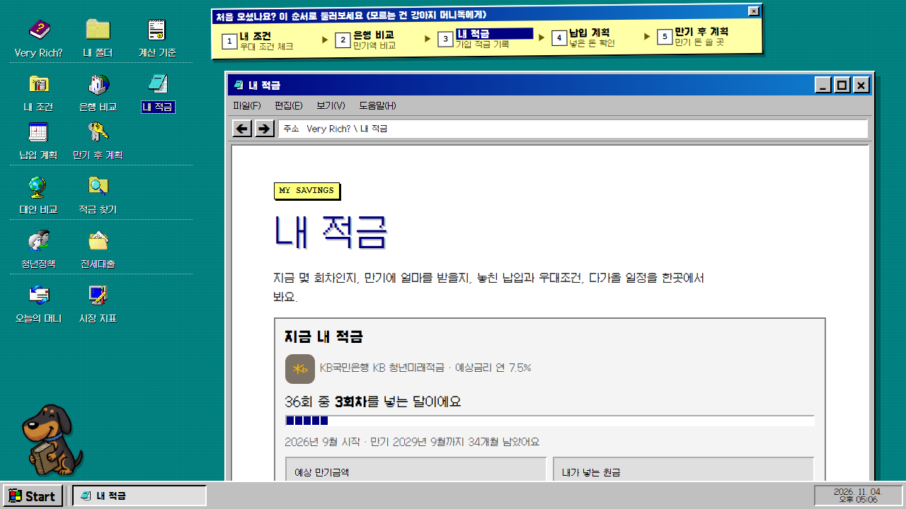

`내 조건`에서 **이미 가입함 / KB국민은행 / 2026년 9월 / 월 30만원**을 입력하면 한 화면에 모입니다.

- **지금 내 적금(실측):** KB국민은행 KB 청년미래적금 · 예상금리 연 7.5% · **36회 중 3회차**(2026년 11월 기준) · 2026년 9월 시작 · 만기 2029년 9월까지 34개월.

| 항목 | 금액 |
|---|---|
| 예상 만기금액 | 12,746,700원 |
| 내가 넣는 원금 | 10,800,000원 |
| 은행 이자 | 1,248,750원 |
| 정부기여금과 이자 | 697,950원 |
| 이번 달까지 넣은 돈 | 900,000원 (3회) |
| 앞으로 넣을 돈 | 9,900,000원 (33회) |

  > 확인: 10,800,000 + 1,248,750 + 697,950 = 12,746,700
- **우대조건:** 반영된 조건 4개(급여이체 +1%p, 생활거래 +0.8%p, 소득 우대 +0.5%p, 청년 재무상담 +0.2%p)와 확인이 필요한 조건 1개(첫 거래·도약계좌 연계). "‘모름’으로 둔 조건을 모두 채우면 만기금액이 최대 83,250원 늘어 12,829,950원이 돼요."
- **이달의 우대조건 체크:** 조건마다 `채웠어요 / 아직이에요 / 못 채웠어요`를 눌러 두면 못 채운 만큼 만기금액이 줄어드는 것을 보여 줍니다(이 기기에만 저장).
- **캘린더 알림(.ics):** 만기 90일 전·30일 전, 남은 납입 달의 25일 오전 9시 우대조건 확인 알림. 파일은 기기 안에서만 만들고 어디에도 보내지 않습니다.
- **연결:** `만기 후엔 어떻게 할까요?`로 예상 만기금액이 자동으로 들어간 만기 후 계획으로, 금리 변동 알림(관심 상품·내 적금 은행의 공시 금리가 전날과 달라지면)을 첫 화면과 오늘의 머니 위에 보여 줍니다.
- **회차는 날짜에 따라 변합니다.** 시연 날짜가 12월이면 4회차로 보입니다.

### 5.5 납입 계획 `/cashflow`

- **목적:** "한 달 못 넣었는데 얼마나 손해일까?"에 답합니다.
- **입력:** 계산할 은행 선택, `앞으로 모든 달에 같은 금액 적용`, 36개월 표(회차 · 구분(지난 달은 *실제*, 앞으로는 *계획*) · 납입액). **미납한 달은 0원**, 덜 낸 달은 실제 금액을 입력합니다.
- **서버 계산:** 변경된 월별 금액으로 원금·이자·정부기여금·기여금 이자·만기액을 다시 계산하고 고정 납입과의 차이를 냅니다.
- **실측(KB, 2026년 12월 4회차를 0원으로):**

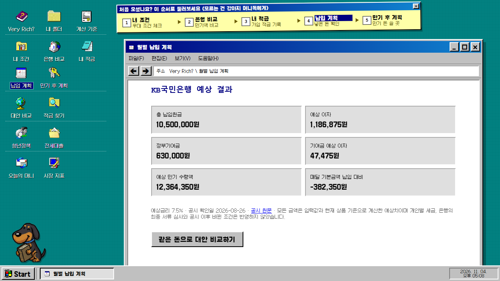

| 총 납입원금 | 예상 이자 | 정부기여금 | 기여금 예상 이자 | 예상 만기 수령액 | 매달 기본금액 납입 대비 |
|---|---|---|---|---|---|
| 10,500,000원 | 1,186,875원 | 630,000원 | 47,475원 | **12,364,350원** | **−382,350원** |

- **`이번 달 납입이 달라지면?`** — 한 달을 골라 *유지 / 감액 / 미납* 세 경우의 만기액을 나란히 비교합니다(`세 가지 비교하기`).
- **해지 전 안내:** 만기 전 해지하면 우대금리와 정부기여금을 못 받을 수 있고 중도해지 이율이 낮다는 점을 먼저 알립니다. **해지 때 받는 돈은 계산하지 않고** 가입 은행에서 확인하라고 안내합니다("추가 확인 필요").
- **다음:** `같은 돈으로 대안 비교하기`(→ 대안 비교).

### 5.6 만기 후 계획 `/maturity`

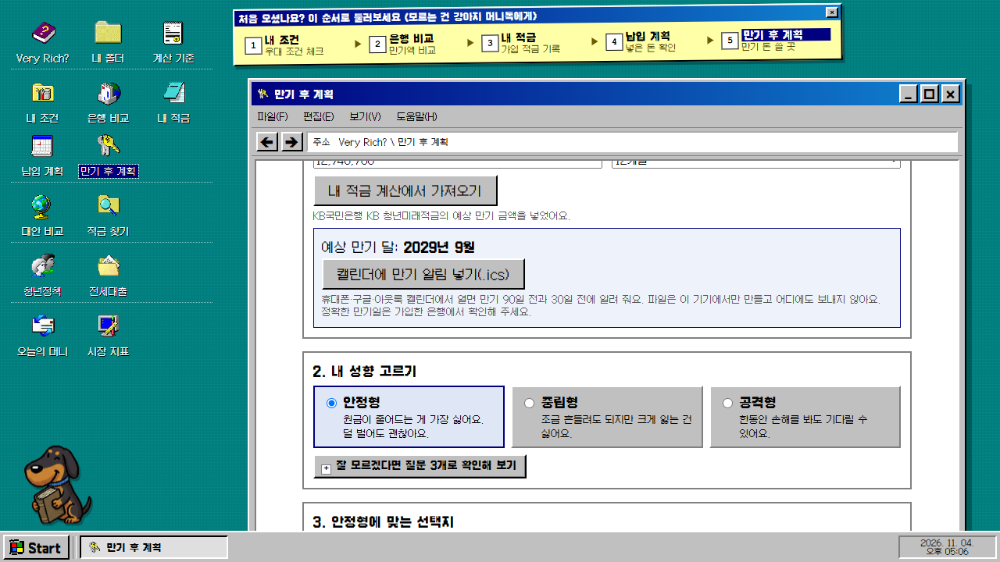

- **목적:** 적금이 끝나 생긴 목돈을 어디에 둘지, **과거 기록**으로 견주어 봅니다.
- **1. 만기 금액과 기간:** `내 적금 계산에서 가져오기`를 누르면 12,746,700원이 자동으로 들어갑니다. 기간 12개월/24개월.
- **2. 성향 고르기:** 안정형(원금이 줄어드는 게 가장 싫어요) / 중립형 / 공격형. 모르겠다면 질문 3개로 확인.
- **3. 성향에 맞는 선택지:** 위험이 낮은 것부터 보여 줍니다. *안정형 12개월*의 실측:
  - **예금에 다시 맡기기** — 연 3.45%(은행 신규 예금 평균금리, 2026년 9월, 한국은행 ECOS) → 12개월 뒤 13,186,461원, 세금(15.4%)을 뗀 뒤 13,118,738원. 원금 보장(예금자보호 한도 안).
  - **BND(채권 ETF)** — 2023년 10월~2025년 9월 *매달 한 번에 넣고 12개월 들고 있었다고 본 과거 결과*: 평균 +8.91%(13,882,431원), 가장 좋았을 때 +17.24%, 가장 나빴을 때 −5.27%(12,074,949원), 손해 본 경우 24번 중 1번.
  - 예금과 섞어 볼 수도 있고, 다른 성향의 선택지 4개도 볼 수 있습니다.
- **4. 실제 정기예금으로 보면:** 금감원에 공시된 은행·저축은행 12개월 정기예금마다, 내 금액을 맡기면 **세후로 얼마 받는지** 계산해 보여 줍니다. `은행 이름으로 찾기`(KB·국민, NH·농협 같은 별칭도 인식), 상품마다 우대 조건·대상·방법·한도를 펼쳐 볼 수 있고, `☆ 관심`으로 모아 금리 변동을 알립니다.
- **캘린더:** `캘린더에 만기 알림 넣기(.ics)`로 만기 90일 전·30일 전 알림.
- **안전장치:** 특정 상품을 권하지 않고, 과거 결과가 미래를 보장하지 않는다고 각 카드에 적습니다.

### 5.7 대안 비교 `/alternatives`

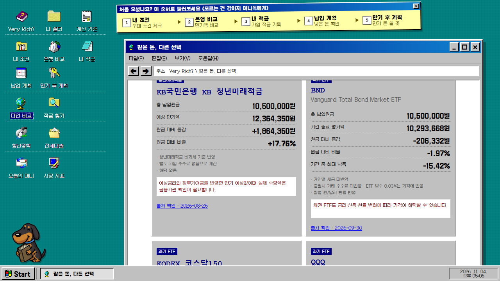

- **목적:** *같은 36개월 납입 순서*를 적금과 ETF 5종에 똑같이 적용해, 서로 다른 기준의 숫자 문제를 없앱니다.
- **입력:** 비교할 적금(14개 은행 중 1개), 함께 볼 투자 대안(BND · 코스닥150 · QQQ · QLD(레버리지) · SCHD).
- **자료 기간:** ETF 2023-10 ~ 2026-09, **배당 재투자·월별 원/달러 환율 반영**, 개인별 세금·증권사 수수료는 반영하지 않음(ETF 보수는 가격에 이미 반영).
- **실측(월 30만원 × 36개월, 원금 10,800,000원):**

| 선택 | 기간 종료 평가액 | 원금 대비 | 기간 중 최대 낙폭 |
|---|---|---|---|
| **KB 청년미래적금** (예상) | 12,746,700원 | +1,946,700원 (+18.03%) | 해당 없음 |
| BND (채권) | 10,616,710원 | −183,290원 (−1.7%) | −15.42% |
| KODEX 코스닥150 | 11,342,576원 | +542,576원 (+5.02%) | −42.58% |
| SCHD (배당) | 12,927,554원 | +2,127,554원 (+19.7%) | −11.97% |
| QQQ (나스닥100) | 14,985,279원 | +4,185,279원 (+38.75%) | −13.91% |
| QLD (QQQ 2배 레버리지) | 18,685,982원 | +7,885,982원 (+73.02%) | −21.47% |

- **읽는 법(발표 멘트):** *과거* 36개월은 주식형 ETF가 더 좋았지만, **최대 낙폭**(중간에 얼마나 떨어졌나)과 "적금은 약속된 금리, ETF는 보장 없음"을 같이 봐야 합니다. 코스닥150의 낙폭은 −42.58%였습니다. 이 표는 순위나 추천이 아니라고 화면 맨 위에 적혀 있습니다.
- KODEX 코스닥150은 코스닥 전체지수가 아니라 대표 150종목을 추종하는 원화 ETF이며 환율을 적용하지 않습니다. 레버리지(QLD)는 위험 안내가 따로 붙습니다.

### 5.8 적금 찾기 `/general-savings` (사용자 C)

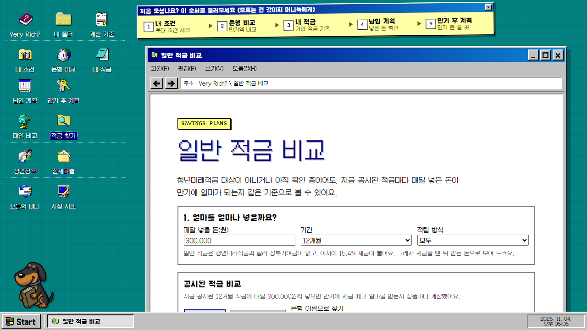

- **대상:** 청년미래적금이 안 되거나 아직 확인 중인 사람.
- **입력:** 매달 넣을 돈, 기간(6·12·24·36개월), 적립 방식(정액·자유), 은행/저축은행, 이름 검색, 정렬(기본금리로 받는 돈 많은 순 / 우대 다 채우면 / 금융회사 이름순).
- **계산:** 일반 적금은 정부기여금이 없고 **이자에 15.4% 세금**이 붙으므로 **세후 만기액**으로 보여 줍니다(단리·복리 구분).
- **실측(12개월 · 월 30만원):** 은행 적금 58개 중 세후 만기액이 가장 적게 3,629,695원(연 1.8%) · 가운데 3,646,192원(연 2.8%) · 가장 많이 3,664,009원(연 3.88%). 원금은 3,600,000원. 같은 돈이라도 상품에 따라 이만큼 차이가 납니다.
- **참고 지표:** 한국은행 기준금리 3%, 은행 신규 예금 평균금리 3.45%(2026.09), 소비자물가 상승률 2.9%(2026.09)를 목록 위에 함께 보여 줍니다.
- 상품마다 `상세`(금리 이력 60일), `가입 조건 보기`, `☆ 관심`. 이름으로 찾으면 "금융감독원에 공시된 상품만 담겨 있어 은행 홈페이지의 전체 상품 수와 다를 수 있다"고 알립니다.

### 5.9 청년정책 `/youth-policies`

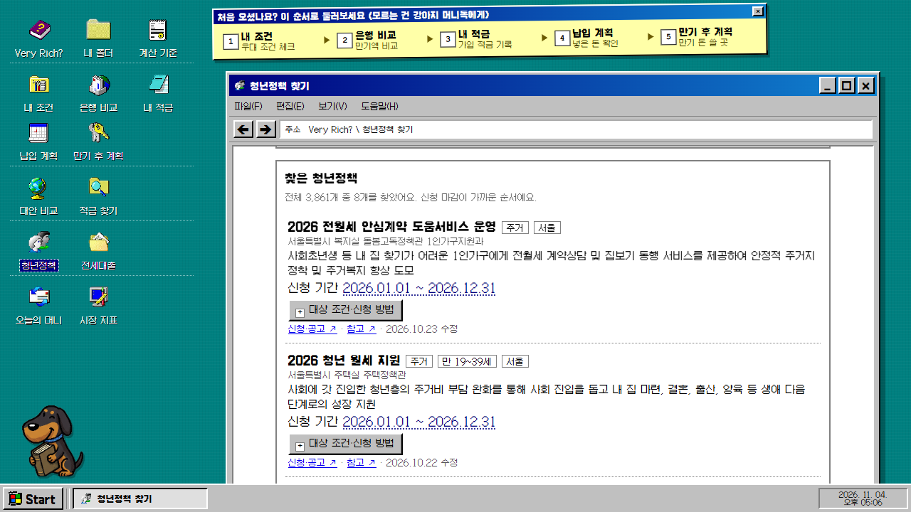

- **자료:** 온통청년 Open API의 청년정책 약 3,900건(시연일 3,861건)을 매일 수집.
- **입력:** 검색어, 분야(교육·일자리·주거·복지문화·참여권리 등), 지역(서울·부산·…), 내 나이(선택), 정렬(신청 마감이 가까운 순 / 최근 수정된 순), `신청 기간이 끝난 정책은 빼기`.
- **예:** "월세" + 만 27세 + 서울로 좁히면 해당하는 정책만 남고, 정책마다 신청 기간, 대상 조건·신청 방법, 신청·공고 링크가 나옵니다.
- **안전장치:** 나이 제한만 걸러 주고 **자격을 판정하지 않습니다**("신청 전에 공고에서 조건을 확인해야 해요"). 입력한 나이는 저장하지 않습니다.

### 5.10 전세대출 `/rent-loans`

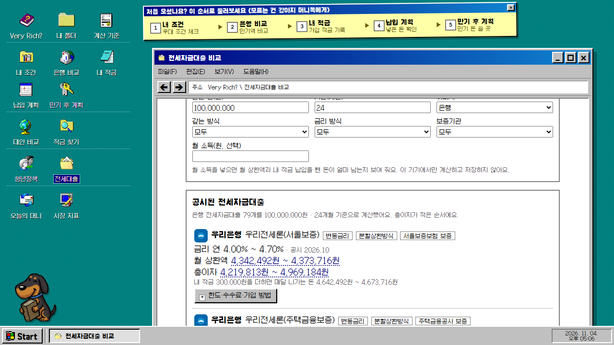

- **입력:** 빌릴 돈, 기간(개월), 은행/저축은행, 갚는 방식(만기일시상환·분할상환), 금리 방식(고정·변동), 보증기관(서울보증보험·주택금융공사·주택도시보증공사), 월 소득(선택).
- **계산:** 금감원 공시 전세자금대출마다 **최저·최고 금리에서의 월 상환액과 총이자**. 총이자가 적은 순.
- **실측(1억원 · 24개월):** 은행 전세자금대출 79개. 예) 우리은행 우리전세론(서울보증) 연 4.00~4.70%, 월 상환액 4,342,492~4,373,716원, 총이자 4,219,813~4,969,184원.
- **내 적금과 연결:** 내 적금 납입 300,000원을 더하면 매달 나가는 돈이 얼마인지 함께 보여 줍니다. 월 소득을 넣으면 상환 후 남는 돈도 계산(이 기기에서만).
- **안전장치:** "어떤 대출을 받으라고 권하지는 않아요." 보증료·인지세·중도상환수수료는 계산에 포함하지 않는다고 적습니다.

### 5.11 오늘의 머니 `/daily`

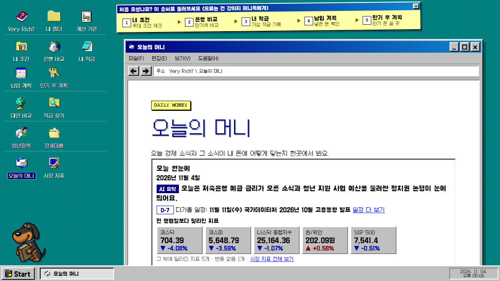

- **오늘 한눈에:** AI 한 줄 요약, 가장 가까운 공식 일정(D-day), **전 영업일보다 달라진 지표**(실측: 코스닥 704.39 ▼4.08%, 코스피 5,648.79 ▼3.59%, 나스닥 종합 25,164.36 ▼1.07% 등).
- **탭:**

| 탭 | 내용 |
|---|---|
| 요약 | 오늘의 경제 뉴스 요약(개요 + 3~5개 항목, 항목마다 원문 링크), "오늘 소식과 내 돈", **만약 기준금리가 바뀐다면?**(오르는 경우·그대로·내리는 경우의 적금 만기액을 같은 조건으로 나란히 계산. *예측이 아님*) |
| 뉴스 | 국내·해외 헤드라인(해외는 AI가 한국어로 옮김), 한국은행 새 소식, 은행·금융지주 공시 |
| 일정 | 금통위·FOMC·물가 발표·선거 같은 공식 일정을 D-day와 출처로 |
| 용어 | 오늘의 금융용어(금융 선생님이 쉬운 말로 풀이) |
| 재무제표 | 은행 재무제표 읽는 법(실제 숫자로 배움) |

- **갱신:** 매일 07:30, 그리고 15:30에 뉴스를 한 번 더 모읍니다(시연일 15:30 갱신 확인).
- **표시:** AI가 쓴 글에는 AI 표시, 출처·발표일·생성 시각. 권유·예측 안내는 맨 아래 한 곳에 모읍니다.

### 5.12 시장 지표 `/market`

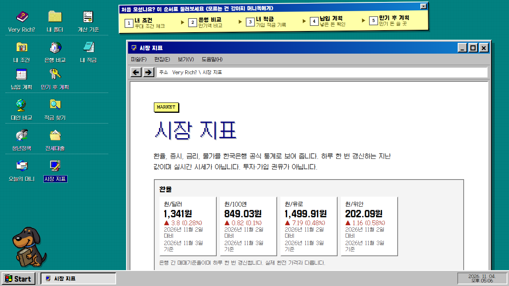

- **묶음:** 환율(원/달러·엔·유로·위안), 국내 증시(코스피·코스닥), 미국 증시(나스닥 종합·S&P 500·다우), 금리(기준금리·국고채), 물가(소비자물가 상승률), 해외 주요국 주가지수(월간), 금리·물가 흐름 그래프.
- **실측 예:** 원/달러 1,341원(▲3.8, 2026-11-03 기준), 한국은행 기준금리 3%(변동 없음), 코스피 5,648.79(▼3.59%).
- **기준일 표기:** 값마다 "○일 대비 · ○일 기준"을 적고, "하루 한 번 갱신하는 지난 값이며 실시간 시세가 아니다"라고 명시합니다. 미국 지수는 FRED 자료로 하루쯤 늦게 올라옵니다.
- **예·적금 공시 금리 변동:** 금감원 공시 금리를 매일 모아 어제와 바뀐 것만 %p로 보여 줍니다.

### 5.13 로그인과 내 정보 `/auth` · `/me`

- **누구나 쓸 수 있습니다.** 로그인 없이 모든 계산이 되고, 로그인은 *저장*을 위한 선택입니다.
- **회원가입·로그인:** Supabase Auth(이메일).
- **내 정보:** 지금 입력을 이름 붙여 **저장한 계획**(최대 10개)으로 저장하고 다른 기기에서 불러오기, 관심 상품 계정 저장. **저장 버튼을 누를 때만** 저장하고 언제든 지울 수 있습니다.

### 5.14 계산 기준 `/about` · 쉬운 용어 풀이 `/terms`

- **계산 기준:** 설문 표본·조사기간, 적금·투자 계산 방법, 상품별 출처·기준일, 반영하지 않은 요소(세금·수수료 등), 글꼴 출처.
- **용어 풀이:** 이 사이트의 숫자를 만드는 말(단리·보증·우대 등)을 쉬운 말로 풀고, 어느 화면에서 쓰이는지 연결합니다. 검색 가능.

---

## 6. 계산 규칙

모든 계산은 FastAPI 한 곳에서 하며, 화면은 복제하지 않습니다. 발표 때 숫자가 어디서 오는지 설명하는 용도입니다.

**청년미래적금 (월 납입액 × 36개월)**

| 항목 | 규칙 |
|---|---|
| 원금 | 월 납입액 × 36 (월별로 고치면 실제 합계) |
| 예상금리 | 은행 기본금리 + (충족했다고 답한 우대금리). **모름·아니요는 더하지 않고, 공시 최고금리를 넘지 않음** |
| 은행 이자 | 각 납입금이 남은 개월만큼 이자를 받는다고 보고 **단리**로 합산 |
| 정부기여금 | 일반형 6%, 우대형 12%, 미대상 0% (원금 기준) |
| 기여금 이자 | 은행 기본금리와 실제 납입 기간으로 계산 |
| 세금 | 정상 만기 비과세 전제로 0원 |
| 예상 만기액 | 원금 + 은행 이자 + 정부기여금 + 기여금 이자 |
| 정렬 | 예상 만기액 큰 순, 같으면 예상금리 높은 순 |

**검산 (실측):** 월 30만원, 일반형, KB 7.5%일 때 원금 10,800,000 + 이자 1,248,750 + 기여금 648,000 + 기여금 이자 49,950 = **12,746,700원**. (기여금 648,000 = 10,800,000 × 6%)

**그 밖의 계산**

- **일반 적금·정기예금:** 세전 이자에서 **이자소득세 15.4%**를 떼고 세후 만기액.
- **투자 대안:** 월말 조정주가(배당 재투자 반영)와 월별 원/달러 환율로, 같은 날짜·같은 금액을 매달 넣었다고 본 *과거* 평가액. 최대 낙폭 계산.
- **전세대출:** 공시 최저·최고 금리와 갚는 방식에 따른 월 상환액·총이자(보증료·인지세·수수료 제외).
- **자동 보증:** 위 계산은 모두 자동 테스트로 고정되어 있습니다(백엔드 353개).

---

## 7. 머니독 (AI 도우미)

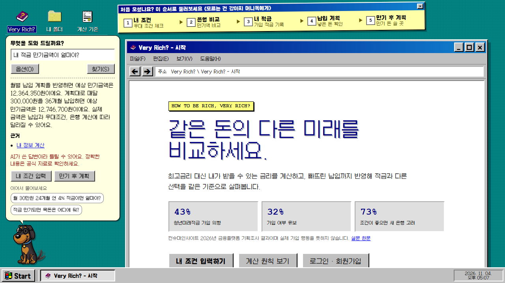

화면 왼쪽 아래 강아지에게 말로 물으면 답합니다. 예) "내 적금 만기금액이 얼마야?" → "계획대로 36개월 모두 납입하면 예상 만기금액은 12,746,700원이에요. 납입 원금 10,800,000원, 이자 1,248,750원, 정부기여금과 그 이자 697,950원을 합한 금액이에요." (근거: `내 정보 계산`, 이어서 물을 질문 제안 포함). 위 스크린샷은 납입 계획에서 12월을 0원으로 바꾼 뒤라 "월별 납입 계획을 반영하면 12,364,350원"까지 함께 말합니다.

**답하는 방식 (RAG + 도구)**

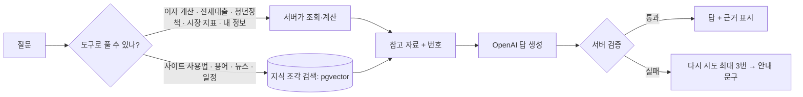

- **무엇을 아는가:** 사이트 안내, 공개 용어, 날짜별 경제 뉴스 요약과 "오늘 소식과 내 돈", 시장 지표(미국 지수 포함), 다가올 공식 일정. 질문과 가까운 5개 조각만 근거로 쓰고 **답 아래에 근거를 보여 줍니다.**
- **도구:** 전세대출 조회, 청년정책 검색, 이자 계산기(금액·기간·금리를 질문에서 읽음), 시장 지표 조회, 상품 금리 변화, 내 정보(내 적금), 관심 상품 금리 변화.
- **내 정보:** "내 적금…"처럼 *나를 가리키는* 질문일 때만 계산에 필요한 값(은행, 월 납입액, 우대 답, 월별 납입액)을 보내며, 서버는 **저장도 로그도 남기지 않습니다.**
- **서버 검증:** 답의 숫자는 인용한 근거에 있어야 함, 추천·권유·수익 보장·예측 표현 거절, 링크는 정해진 화면만, 이 지침을 알려 달라는 요청 거절, 사용자 글·기사 제목 속 지시는 따르지 않음.
- **모르면 모른다:** 자료에 없는 사실은 "이 자료에는 없다"고 말하고 은행·금융감독원 같은 공식 기관을 안내합니다. 최근 소식을 물으면 기사 제목과 지표에서 알 수 있는 것을 날짜와 함께 먼저 알려 줍니다.
- **운영 값:** 접속 주소별 분당 5회·하루 60회 제한, 같은 공개 질문은 15분 기억, 대화는 최근 6개 말만 사용(서버 저장 없음). 키가 없으면 키워드 답변만 합니다.
- **안내문 고정:** 답마다 "AI가 쓴 답변이라 틀릴 수 있어요. 정확한 내용은 공식 자료로 확인하세요."

**시연 질문 모음 (실제로 답이 나오는 것)**

| 질문 | 쓰이는 것 |
|---|---|
| 내 적금 만기금액이 얼마야? | 내 정보 계산 |
| 왜 내 예상 금리가 7.5%야? | 우대조건 이유 설명 |
| 월 30만원 24개월 연 4% 적금이면 얼마야? | 이자 계산기 |
| 서울에서 받을 수 있는 월세 지원 정책 알려줘 | 청년정책 검색 |
| 전세대출 금리 알려줘 | 전세자금대출 조회 |
| 오늘 나스닥 어때? | 시장 지표 + 오늘 기사 |
| 예금자보호가 뭐예요? | 용어 풀이 |
| 어떤 은행이 제일 좋아? | **"추천하지 않는다"고 정중히 거절** (안전장치 시연용) |

---

## 8. 데이터와 자동화

| 자료 | 출처 | 갱신 |
|---|---|---|
| 청년미래적금 14개 취급기관의 기본·최고금리, 우대조건 | 각 은행·금융위원회 공시(출처 링크와 확인일 표기) | 주 1회 원문 변경 감지 → **사람이 대조 후** 반영 |
| 일반 적금·정기예금·전세대출 공시 금리 | 금융감독원 금융상품 한눈에 Open API | 매일 |
| 환율·증시·기준금리·물가 | 한국은행 ECOS | 매일 |
| 미국 주가지수 | 미국 세인트루이스 연방준비은행(FRED) | 매일(하루쯤 지연) |
| 청년정책 | 온통청년 Open API | 매일 |
| 은행 재무제표·공시 | 금융감독원 전자공시(DART) | 수집 시 |
| 뉴스 헤드라인 | 네이버 뉴스 검색 API(기사 전문 저장 안 함) | 매일 07:30, 15:30 |
| ETF 가격·환율(대안 비교) | 월말 조정주가·월별 환율 | 매월 3일 09:00(KST) 자동 갱신, 검증 통과 시에만 교체 |

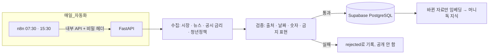

- **실패해도 안전하게:** 수집·검증이 실패하면 이전 정상 자료를 유지하고, 한 출처가 실패해도 나머지는 계속 처리합니다. 실행 기록과 하루 토큰 상한 표시가 있습니다.
- **원문을 가져다 쓰지 않습니다:** 기사 전문을 저장·재게시하지 않고 제목·출처·링크와 AI 요약만 보여 줍니다.

---

## 9. 신뢰·안전 원칙

| 원칙 | 구현 |
|---|---|
| 추천·권유 금지 | 순위는 계산 결과일 뿐이라고 표기. 머니독은 추천 질문을 거절. AI 글에서 권유·예측 표현은 서버가 거절 |
| 근거 있는 숫자만 | AI가 쓴 숫자는 인용한 근거 자료에 있어야 통과. 금액은 단위만 바꿔 읽는 것 허용 |
| 출처·기준일 | 상품·지표·뉴스마다 출처 링크와 확인일, "실시간 시세 아님" 표기 |
| 개인정보 최소 | 개인정보 처리방침·이용약관 화면(`/privacy`, `/service-terms`)과 가입 때 필수 동의. 비회원 입력은 브라우저에만. 대상 확인의 생년월일·소득은 저장 안 함. 로그인해 *저장*을 누른 것만 계정에. 통계는 동의한 사람에게서만 익명으로 |
| 불확실성 정직 | "모름"은 금리에 더하지 않고 최대로 늘어날 금액을 따로 보여 줌. 계산하지 않은 것(해지 환급액·세금·수수료)은 "추가 확인 필요"로 표시 |
| 비밀값 | API 키·비밀번호는 `.env`와 n8n Credential에만. 코드·문서·Git에 넣지 않음, 워크플로 JSON에는 환경변수 *이름*만 |
| 접근성 | 키보드 포커스 표시, 360px 모바일, 누르는 영역 24px 이상, 15개 화면 axe 위반 0 |

---

## 10. 품질 확인 결과

| 구분 | 결과 |
|---|---|
| 자동 테스트 | 프론트엔드 238개, 백엔드 353개 통과(push마다 CI로 자동 실행), 타입 검사·린트 통과 |
| 머니독 평가 | 일반 질문 묶음(답 못함 0, 오류 0) · 말투 평가(놓친 것 0/31) · 안전성 평가(위반 0/30) · 최신 소식 평가(날짜 없는 답·근거 없는 사실 수용·전망 0/13) |
| 검색 품질 | 질문 32개, 글자 일치를 더한 하이브리드 검색 hit@1 81%, **hit@5 100%**, MRR 0.89 (의미 검색만: 62%, 97%, 0.76) |
| 처음 온 사람 흐름 QA | 데스크톱·폰 크기·키보드·서버 오류·운영 빌드까지 실제 방문자 흐름을 돌려 발견한 문제 수정 (예: 만기 후 계획 가져오기 오류, 첫 화면 가림, 금액 한글 단위, 404 안내, 누르는 영역) |
| 숫자 일관성 | 은행 비교·내 적금·만기 후 계획·머니독이 같은 입력에서 같은 금액을 냄(국민은행 12,746,700원) |
| 첫 방문 용량 | 약 3.0MB → **921KB** (화면별 코드 분할, 글꼴·아이콘 축소) |
| 오류 대응 | 서버 503, 전체 중단, 머니독 429에서도 빈 화면 없이 안내와 다시 시도 |

---

## 11. 시연 시나리오

### 11.1 시연 전 준비 (발표 30분 전)

- [ ] 백엔드 `http://localhost:8000/api/v1/health` 응답 확인, 프론트 `http://localhost:5173` 열기
- [ ] **새 브라우저 창(시크릿)** 으로 열기 → 이전 입력이 없는 "처음 온 사람" 상태. 아니면 `내 조건`의 `처음부터 다시 입력`
- [ ] 통계 동의 바는 `보내지 않을래요`로 닫기
- [ ] 인터넷 연결(머니독·DB 필요), 머니독은 **분당 5회** 제한이므로 질문은 미리 3~4개만 골라 두기
- [ ] 화면 해상도 1280×720 이상, 브라우저 확대 100%
- [ ] 15:30 이후 오늘의 머니에 뉴스가 있는지 확인
- [ ] 가입 중 화면(회차)은 *시연 날짜에 따라* 달라짐 → 값은 그 자리에서 읽기
- [ ] 비상용: 이 문서의 스크린샷(`docs/images/`)

### 11.2 5분 버전 — "최고금리 vs 예상금리"

| 시간 | 할 일 | 말할 것 |
|---|---|---|
| 0:00 | 첫 화면 | "은행 광고의 최고금리는 아무나 못 받습니다. 내가 받을 수 있는 금리를 계산합니다." |
| 0:40 | 내 조건 → `내 조건으로 확인해 보기` (1999-03-15 · 총급여 5,000 · 가구 5,000) | "일반형으로 가입할 수 있어요. 우대형이 되려면 무엇이 필요한지도 알려 줍니다." |
| 1:30 | 월 300,000원, 일반형 6%, 공통 2문항 "예", KB 은행별 질문 펼쳐 급여이체·생활거래 "예" | "모름은 금리에 더하지 않습니다." |
| 2:30 | `지금 답변으로 14개 비교하기` | "KB 7.5%·12,746,700원, 다른 은행은 5.7%·12,447,000원. 최고금리와 이만큼 다릅니다." |
| 3:30 | `왜 이 금리인가요?` 펼치기 | "기본 5% + 소득 0.5 + 상담 0.2 + 급여이체 1.0 + 생활거래 0.8 = 7.5%" |
| 4:15 | 머니독에게 "어떤 은행이 제일 좋아?" | "추천하지 않고 같은 기준으로 비교만 돕습니다." |

### 11.3 10분 버전 — "내 적금 따라가기" (5분 버전 + 아래)

| 시간 | 할 일 | 말할 것 |
|---|---|---|
| 4:30 | `내 조건`에서 **이미 가입함** / KB국민은행 / 2026년 9월 → `내 적금` | "지금 3회차, 예상 만기금액 12,746,700원. 숫자는 은행 비교와 같습니다." |
| 5:30 | 우대조건 체크에서 하나를 `못 채웠어요` | "못 채우면 만기금액이 얼마나 줄어드는지 바로 봅니다." |
| 6:15 | `납입 계획` → 2026년 12월을 0원 → 다시 계산 | "한 달 못 넣으면 원금 10,500,000원, 만기 12,364,350원. **−382,350원**" |
| 7:15 | `만기 후 계획` → 가져오기 → 안정형 | "예금 3.45%면 12개월 뒤 세후 13,118,738원. BND 과거 결과는 평균 +8.91%, 손해 24번 중 1번" |
| 8:30 | `대안 비교` → 같은 현금흐름으로 비교하기 | "과거 36개월: QQQ +38.75%, 그런데 코스닥150은 최대 낙폭 −42.58%. 추천이 아니라 *같은 기준의 설명*입니다." |
| 9:30 | 머니독 "내 적금 만기금액이 얼마야?" | "내 화면과 같은 숫자를 말하고 근거를 보여 줍니다." |

### 11.4 15분 버전 — 5분 + 10분 + 부가 기능

| 시간 | 할 일 | 말할 것 |
|---|---|---|
| 10:00 | `적금 찾기` (대상 아닌 경우) | "공시 적금 58개를 세후 만기액으로. 1.8%와 3.88%의 차이가 약 3만 4천원." |
| 11:00 | `청년정책` → 월세·27세·서울 | "3,861건 중 내게 해당하는 것만. 자격 판정은 하지 않고 공고로 보냅니다." |
| 12:00 | `전세대출` → 1억·24개월 | "내 적금 납입을 더하면 매달 나가는 돈까지 보입니다." |
| 12:45 | `오늘의 머니` | "AI 요약, 달라진 지표, 일정, '기준금리가 바뀐다면?'" |
| 13:45 | `시장 지표` | "실시간이 아니라 *하루 한 번 갱신한 지난 값*이라고 적어 둡니다." |
| 14:15 | 창 최대화·복원·내 폴더 지뢰찾기 | "금융이 낯선 사람을 위한 익숙한 바탕화면. 지뢰찾기는 풀수록 판이 커지는 레벨제." |

### 11.5 시연 중 문제 대처

| 상황 | 대처 |
|---|---|
| 머니독이 "지금은 답하기 어려워요" | 호출 제한(분당 5회) 또는 네트워크. 잠시 후 다시, 또는 미리 찍은 `docs/images/14-assistant.png` 보여 주기 |
| 은행 비교가 비어 있음 | `다시 시도` 단추, 서버 `/api/v1/health` 확인 |
| 숫자가 문서와 다름 | 날짜가 달라서(회차·지표) 또는 입력이 다름. 입력칸 값을 먼저 확인하고 화면 숫자를 그대로 읽기 |
| 오늘의 머니가 어제 날짜 | 15:30 갱신 전. "하루 두 번 갱신한다"고 설명 |

---

## 12. 예상 질문과 답

**Q. 은행이 이미 비교 서비스를 하지 않나요?**
A. 기존 서비스는 대부분 *최고금리*나 *기본금리*로 줄을 세웁니다. 이 서비스는 우대조건을 내가 채울 수 있는지를 반영한 **예상금리**, 그리고 덜 낸 달까지 반영한 **현실의 만기액**을 계산하는 데 초점을 둡니다.

**Q. 계산이 틀리면요?**
A. 모든 금액은 서버 한 곳에서 계산하고 자동 테스트(백엔드 353개)로 고정했습니다. 화면에는 항상 "예상 결과이며 실제 가입 조건과 수령액은 금융기관의 최종 확인이 필요하다"고 적고, 계산하지 않은 것(해지 환급액·세금·수수료)은 *추가 확인 필요*로 표시합니다. 숫자 하나를 검산하는 식은 [6. 계산 규칙](#6-계산-규칙)에 있습니다.

**Q. 공시 데이터가 최신인가요? 누가 확인하나요?**
A. 일반 적금·전세대출·청년정책은 매일 자동 수집합니다. 청년미래적금 상품 정보는 주 1회 원문 변경 여부만 확인하고 **사람이 원문과 대조한 뒤** 반영합니다. 화면마다 출처 링크와 기준일이 있습니다.

**Q. AI가 거짓말하면요?**
A. 머니독은 *검색된 근거 자료와 서버 계산 결과*에서만 답하도록 하고, 서버가 답의 숫자를 근거와 대조합니다. 근거가 없으면 "자료에 없다"고 말하게 했고, 틀릴 수 있다는 안내를 답마다 붙입니다. 평가 3종(일반·말투·안전성)과 검색 품질 평가를 따로 돌립니다.

**Q. 머니독이 방금 난 뉴스를 모르던데요?**
A. 설계상 웹을 검색하지 않고 우리가 모은 자료로만 답합니다. 뉴스는 하루 두 번 갱신하고, 자료에 없는 사실은 인정하지 않되 기사·지표에서 알 수 있는 것을 날짜와 함께 알려 줍니다. 웹 검색을 붙이는 것은 비용·응답 시간·출처 검증 문제로 배포 후에 정할 계획입니다.

**Q. 개인정보는 어떻게 다루나요?**
A. 로그인 없이 쓸 수 있고, 입력은 브라우저에만 저장됩니다. 가입 대상 확인에 넣는 생년월일·소득은 아무 데도 저장하지 않습니다. 계정에는 사용자가 *저장을 누른* 계획과 관심 상품만 저장합니다. 머니독은 "내 정보"를 물을 때만 계산에 필요한 값을 보내고 저장·로그를 남기지 않습니다.

**Q. 왜 ETF까지 비교하나요? 투자 권유 아닌가요?**
A. 같은 현금흐름을 *과거* 36개월에 적용한 설명 자료입니다. 순위·추천이 아니라고 화면 맨 위에 적고, 최대 낙폭·레버리지 위험·세금과 수수료 미반영을 항상 함께 보여 줍니다.

**Q. 일반 사람이 쓰기엔 어렵지 않나요?**
A. 바탕화면과 폴더라는 익숙한 구조로 복잡한 기능을 아이콘 하나씩으로 나눴고, 포스트잇이 순서를 안내하며, 모르는 말은 `쉬운 용어 풀이`와 머니독이 풀어 줍니다. 모르는 우대조건은 "모름"을 고르면 됩니다.

**Q. 어떻게 개발했나요?**
A. React + FastAPI + Supabase PostgreSQL이고, Claude Code가 구현하고 Codex가 리뷰하는 멀티에이전트 방식으로 만들었습니다. 매일 수집은 n8n으로 자동화했습니다.

**Q. 돈은 어떻게 버나요? 앞으로는?**
A. 현재는 광고·권유 없이 비교와 이해에 집중한 첫 버전입니다. 수신(예금·적금) 사업에 붙이는 가정 제안서는 [proposal_deposit_growth.md](proposal_deposit_growth.md)에 있습니다.

---

## 13. 한계와 앞으로

**솔직한 한계**

- 실제 가입 심사·최종 조건은 은행이 하며, 이 서비스의 숫자는 **예상**입니다.
- 해지 환급액, 개인별 세금, 증권사 수수료는 계산하지 않습니다.
- 우대조건은 은행이 정한 기간 동안 계속 채워야 하는 경우가 많은데, 월별 충족 여부 체크는 이 기기에만 저장되는 보조 기능입니다.
- 청년정책은 자격을 판정하지 않고 나이 제한만 거릅니다.
- 머니독은 하루 두 번 갱신되는 자료로만 답하므로 방금 난 뉴스는 늦습니다.
- 실제 휴대폰·화면 낭독기 확인과 Safari·Firefox 확인은 하지 못했습니다.
- 화면의 일부 아이콘은 공개 배포 전에 사용 권한을 확인해야 합니다.

**배포와 다음 일**

- **2026-11-09 배포 예정.** 개인정보 처리방침·이용약관 화면과 가입 동의는 만들었습니다(법률 검토, 문의 연락처 입력 `VITE_CONTACT_EMAIL`, 계정 삭제 방법 정하기가 남음). 필요한 것: 모든 경로를 `index.html`로 돌리는 서버 설정, 허용 주소(CORS), 실패 알림, 상시 서버(FastAPI + n8n).
- 예약 작업 3회 연속 성공 확인, 사용자 테스트(Phase 10).
- 장기: 최신 뉴스 질문에 한정한 웹 검색, 실제 기기 테스트, 이메일 알림.
